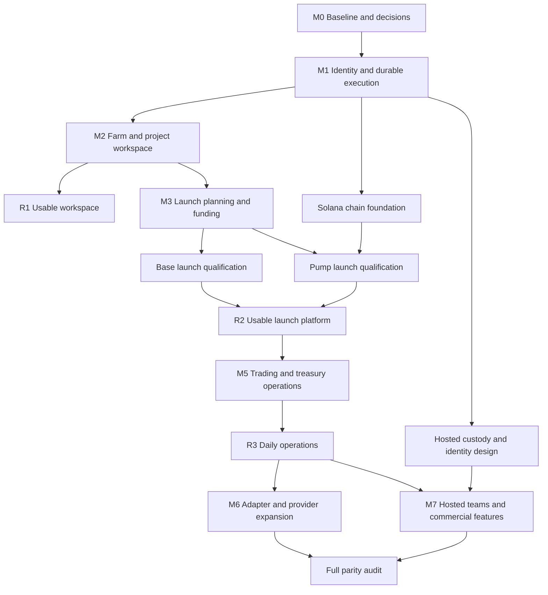

# Wallet Studio implementation plan

Status: proposed build plan; all work items are unstarted unless separately evidenced in the repository.

Prepared: 5 October 2026. Canonical checkout: `D:/Shared/GitHub/wallet-studio`.

Inputs: [product requirements](./prd.md), [technical specification](./specs.md), and [Sumo screenshot evidence](./prd.md#11-screenshot-evidence). This document turns those requirements into an ordered, testable build program. It does not authorize transactions, deployment, or migration of real wallet data.

## 1. What we will deliver first

Build a local-first platform in which one operator can manage reusable wallets, import an existing token, prepare and fund a launch, execute through a qualified adapter, and monitor or recover the resulting operations. Preserve current Wallet Studio functionality throughout the build.

The recommended initial networks are Base and Solana. Base provides the shortest path to reusing existing code. Solana is necessary for the priority Pump launch and farm workflows, and must influence the shared interfaces from the start.

Deliver complete user workflows incrementally. Each feature includes its UI, server validation, persistence, permissions, progress/error states and meaningful tests. A frontend connected only to fabricated success responses is a demonstration, not a usable release.

### Release boundaries

| Release | What the operator can do | What is deliberately later |
|---|---|---|
| R0 — development rehearsal | Run isolated seeded demonstrations of inventory, plans and job recovery; use all existing supported workflows | New production trading or launches |
| R1 — usable wallet and project workspace | Generate/import wallets; manage folders/readiness; copy/move memberships; import an existing Base token; fund/collect, execute supported manual swaps and bounded farm activity; inspect receipts and recover interrupted jobs | New-token launch, marketplace, privacy funding, bridging, hosted teams |
| R2 — usable launch platform | Complete the six-stage launch workflow for qualified Base Uniswap V2 and Solana Pump SOL adapters; fund roles, simulate, execute, reconcile, redistribute where supported, and operate the resulting project | Other launchpads/quotes, graduation sniping, advanced commercial features |
| R3 — daily operations platform | Use DCA/counter/conditional limit strategies, treasury distributions/swaps/rotation, charts, multi-chart, logs and performance reporting | Complete network coverage and hosted/commercial parity |
| R4 — expanded integrations | Use additional qualified launchpads, treasury/market providers, marketplace, privacy funding and cross-chain transfers | Any adapter still lacking contracts, access, review or recovery evidence |
| R5 — hosted teams and parity closure | Use isolated organizations, permissions, portals, settlement/rewards/referrals and qualified remaining capabilities | Nothing silently omitted: unresolved capabilities stay explicitly tracked |

R1 is useful before new-token deployment exists. R2 is the first release that satisfies the combined farm-to-launch objective in the PRD. R2 may ship each chain to a controlled pilot independently, but is not complete until both named adapters pass their gates. R5 is not “full parity” while any required capability remains unresolved.

### R2 usable-platform contract

An operator must be able to complete this sequence without editing database files, manually repairing nonces, or interpreting raw exception traces:

1. Start/unlock the application and understand its active network and signing state.
2. Create or import wallets, organize them, inspect freshness/readiness, and assign them to a project or launch role.
3. Preview funding and complete a supported bounded activity job.
4. Save a launch draft, resume it, inspect per-wallet funding shortfalls and simulate the final plan.
5. Execute an approved qualified launch and view real transaction identities and resulting assets.
6. Recover after a browser disconnect or service restart without repeating a confirmed purchase or deployment.
7. See holdings, submit a supported manual trade, collect remaining assets, and export a redacted operation report.

Out-of-scope controls must be hidden or clearly marked unavailable with a reason. Do not show clickable launch options that route to generic placeholder behavior.

## 2. Execution assumptions and responsibility

Use relative weeks from an agreed kickoff, not calendar promises. Indicative staffing is four engineers with backend/protocol, frontend/product, execution/security and data/integration ownership, plus product/design support, QA capacity and independent contract/security review. One person can cover several roles, but estimates must be revised accordingly.

| Owner label | Responsibility |
|---|---|
| Platform | Persistence, identity, API contracts, migrations and job infrastructure |
| Execution | Signing, budgets, reservations, transaction recovery and custody boundaries |
| Protocol | Chain/DEX/launch adapters, reproducible artifacts and protocol qualification |
| Product UI | Workflows, tables, wizard, accessibility and actionable error states |
| Data | Receipt indexing, balances, chart/feed ingestion, analytics and attribution |
| QA/Review | Failure injection, regression, user acceptance, contract/security review evidence |

Owners below are proposed delivery responsibilities, not assigned people or agents. Start external-provider access and contract discovery early; production integration work depends on their outcomes.

## 3. Critical path and sequencing

The key dependency is shared wallet coordination before concurrent financial operations. Farm, launch, manual trading and existing NFT workflows must not use independent nonce/balance assumptions. A sophisticated chart or new launchpad does not justify bypassing this dependency.

### Indicative delivery windows

| Milestone | Active effort window | Approximate position after kickoff | Release result |
|---|---|---|---|
| M0 baseline and decisions | 1–2 weeks | Weeks 1–2 | R0 preparation |
| M1 foundations and recovery slice | 2–4 weeks | Weeks 2–5 | R0 demonstrated |
| M2 farm and existing-token workspace | 4–6 weeks with UI work overlapping M1 | Weeks 4–9 | R1 candidate |
| M3 launch planning/funding | 3–5 weeks | Weeks 8–13 | Launch rehearsal candidate |
| M4 first launch adapters and pilot | 4–8 weeks, partly parallel by chain | Weeks 11–20 | R2 candidate |
| M5 trading/treasury/reporting | 6–10 weeks | Weeks 18–30 | R3 candidate |
| M6 protocol/provider expansion | 10–18+ weeks in waves | After shared adapters stabilize | R4 delivered by qualified integration |
| M7 hosted/commercial/parity | 6–10+ weeks plus closure | Design early; production after R3 foundations | R5 candidate |

These are engineering estimates, not observed throughput. External access, independent review and remediation can extend elapsed time. Re-estimate after M0 and after the first real adapter; do not sum overlapping rows as if they were sequential commitments. With materially less staffing, use milestone order rather than these week ranges.

## 4. M0 — Establish a trustworthy baseline

Outcome: the team knows what works today, what must remain compatible, and which first integrations are feasible.

| Task | Owner | Depends on | Deliverable and acceptance |
|---|---|---|---|
| BLD-001 Baseline and regression inventory | Platform + QA | None | Record current build/test results using isolated fixtures, entry points, persisted schemas and protected execution gates. Distinguish pre-existing failures from new failures. |
| BLD-002 Initial release decisions | Platform + Product UI | BLD-001 | Record local-first delivery, R1/R2 scope, Base/Solana identifiers, initial operation limits, readiness policy and unsupported states in an architecture decision record. |
| BLD-003 Protocol/provider feasibility | Protocol | BLD-002 | Verify current primary documentation, deployments, quote/RPC/relay access and review requirements for Base Uniswap V2 and Pump SOL. Produce a dependency register with owner, next action and fallback. |
| BLD-004 Workflow and fixtures | Product UI + QA | BLD-002 | Map SS-01–SS-13 to our original UI; define synthetic empty/funded/stale/failed/partial states and acceptance walkthroughs before production data is used. |

- [ ] Existing tests/build results recorded; real `.env`, vaults and wallet data excluded from fixtures.
- [ ] Every existing financial entry point is listed for shared-lock integration.
- [ ] First adapters have a feasible execution and recovery design; unresolved assumptions are documented.
- [ ] Environment setup can be repeated by another developer from repository instructions.

Do not remove current mainnet restrictions to make a demo pass. Do not assume the current ERC20 source or direct Base sequencer submission is sufficient for a reviewed launch product.

## 5. M1 — Identity, persistence and one recoverable operation

Outcome: a complete API-to-UI operation can survive interruption while existing functionality remains usable.

| Task | Owner | Depends on | Deliverable and acceptance |
|---|---|---|---|
| BLD-005 Family-aware domain and registry | Platform + Protocol | BLD-002, BLD-003 | Define chains/assets/key handles/accounts/memberships and operation capabilities. Native assets and exact units cannot be confused with contract assets or display symbols. |
| BLD-006 Transactional metadata storage | Platform | BLD-005 | Select and exercise SQLite on the supported Windows/Node environment; add versioned migrations, journal/outbox and legacy read adapter. Dry-run migration is idempotent and preserves identifiers/history. |
| BLD-007 Shared reservations and signing leases | Execution | BLD-005, BLD-006 | Coordinate all signing paths by chain/address, including existing funding/NFT/curve workflows. Two competing operations cannot reserve the same available funds or allocate an incompatible nonce. |
| BLD-008 Durable job runner | Execution + Platform | BLD-006, BLD-007 | Implement admission, steps, attempts, fencing, pause/cancel and restart recovery. Persist spend-authorizing boundaries; unknown outcomes remain unresolved until reconciled. |
| BLD-009 Plans and authorization | Execution | BLD-005, BLD-008 | Add canonical plan hash, expiry, spend/fee limits, server validation and bounded signing authority. Changed inputs or revoked authority cannot reuse stale approval. |
| BLD-010 Operation center and event stream | Product UI + Platform | BLD-008, BLD-009 | Show active/history views, per-step receipts and recovery actions with reconnect/replay. Drive it through a real test-environment transfer and injected crash, not just seeded status changes. |

Relevant existing code: [direct sender](../src/core/DirectTransactionSender.ts), [transaction safety](../src/core/transactionSafety.ts), [wallet manager](../src/wallet/WalletManager.ts), [funding service](../src/studio/FundingService.ts), [NFT campaigns](../src/nft/CampaignService.ts), [JSON store](../src/database/JsonStore.ts), [server](../src/studio/server.ts).

Proposed new areas: `src/storage/`, `src/jobs/`, `src/signing/`, `src/domain/wallets/`, `src/adapters/`, and an operation-center feature under `ui/features/`. Create them through working slices rather than empty scaffolding.

- [ ] R0 rehearsal: submit, disconnect, restart and reconcile one test operation without duplicate intent or debit.
- [ ] Losing a worker lease blocks further signing; unresolved reservations survive lease expiry.
- [ ] Vault lock stops new signing while public receipt monitoring remains available.
- [ ] Regression checks cover all existing financial paths touched by shared coordination.

## 6. M2 — Usable Wallet Farm and existing-token workspace

Outcome: R1 provides useful wallet preparation and token operations before new launches are enabled.

| Task | Owner | Depends on | Deliverable and acceptance |
|---|---|---|---|
| BLD-011 Farm inventory and acquisition | Platform + Product UI | BLD-005–BLD-010 | Generate/import wallets, rename, folder, search/filter/page, activate and copy from projects. Invalid rows are isolated; no key material enters logs; duplicate wallet identities are rejected or linked correctly. |
| BLD-012 Observations and readiness | Data + Product UI | BLD-011 | Fetch balances and funded/activity evidence with timestamps; calculate versioned readiness reasons. Separate unknown, stale, inactive and not-ready states. |
| BLD-013 Project import and memberships | Platform + Product UI | BLD-011 | Import an existing Base token/pool and assign wallets by copy/move. Correct chain/assets/provider, project lifecycle and portfolio deduplication are enforced. Import never deploys. |
| BLD-014 Swap and direct funding slice | Protocol + Execution | BLD-003, BLD-009, BLD-013 | Qualify one Base swap route; implement per-wallet funding/collection and manual buy/sell preview, submit and receipts through the shared execution path. |
| BLD-015 Farm activity runner | Execution + Product UI | BLD-012, BLD-014 | Add pair/amount ranges, token source, dust, delay, provider and concurrency controls; persist schedule and buy/sell leg results. A failed sell leaves a visible recoverable holding. |
| BLD-016 R1 packaging and acceptance | QA + Product UI | BLD-010–BLD-015 | Add launch/start instructions, provider setup, lock/offline states, operation report export, backup/restore procedure and guided first use. Pass the R1 demo below. |

Screenshot references: [farm controls](./screenshots/sumo/01-farm-controls.jpg), [readiness](./screenshots/sumo/02-farm-readiness.jpg), [acquisition](./screenshots/sumo/03-wallet-acquisition.jpg), [activity](./screenshots/sumo/05-farm-activity.jpg), [token import](./screenshots/sumo/12-token-import.jpg).

Proposed new areas: `src/domain/farm/`, project membership services, Base swap adapters and `ui/features/farm/`. Extend [existing UI/API](../ui/api.ts) without replacing supported screens wholesale.

### R1 acceptance demo

Use owned test wallets and controlled assets/routes in a fixture or fork environment:

1. Create 12 wallets, import a duplicate and malformed key, and confirm row-level feedback without secret exposure.
2. Organize the wallets in two folders, inspect unknown/known readiness evidence, and verify filtered totals.
3. Import a supported token, copy two wallets and move two others into it; demonstrate unchanged actual balances and correct membership totals.
4. Fund selected wallets, preview one manual swap, and complete it with a receipt.
5. Run a small bounded activity job, interrupt after a buy, restart and reconcile the sell without buying twice.
6. Collect remaining supported assets and export the operation history.

- [ ] All six steps can be performed in the UI, including interruption recovery.
- [ ] No fake age, fabricated funding source or activity count derived merely from queued requests.
- [ ] Existing wallet cap stays enforced until separately qualified; synthetic large-table tests do not enable larger financial jobs.
- [ ] Production paths are enabled only for individually qualified operations after release review. A test-only R1 candidate is labeled accordingly.

## 7. M3 — Complete launch planning and funding

Outcome: a real saved plan links farm wallets to launch-specific requirements and can be rehearsed without a live deployment.

| Task | Owner | Depends on | Deliverable and acceptance |
|---|---|---|---|
| BLD-017 Solana foundation | Protocol + Execution | BLD-005–BLD-009 | Add explicit Solana keys/accounts/assets, fee/rent planning, transaction identity/expiry and receipt recovery. Reuse job policy without forcing EVM nonce assumptions. |
| BLD-018 Launch draft and wizard | Platform + Product UI | BLD-013, BLD-009 | Implement six stages, adapter-driven fields, metadata/image storage, persistent summary, revisions and draft resume. Unavailable adapters state why. |
| BLD-019 Role materialization and funding | Execution + Product UI | BLD-011, BLD-014, BLD-018 | Assign farm/imported/new wallets by role; materialize idempotently; show current/required/reserved/shortfall per asset; fund only reviewed requirements. |
| BLD-020 Simulation and final review | Protocol + Execution | BLD-019 | Bind simulation, terms and approval to plan revision; explain irreversible authority choices and atomicity. Changing material inputs invalidates approval. |

Build Base and Solana schemas together, even if the first working adapter is Base. Solana launch funding and signing cannot be admitted until BLD-017 passes its own conformance tests.

References: [launch metadata](./screenshots/sumo/07-launch-info.jpg), [allocation](./screenshots/sumo/08-launch-buy-setup.jpg), [funding/cleanup](./screenshots/sumo/09-launch-funding-cleanup.jpg), [roles](./screenshots/sumo/10-launch-wallet-roles.jpg), [materialization prerequisite](./screenshots/sumo/11-launch-wallet-creation-gate.jpg).

- [ ] Closing/reopening a draft preserves roles and estimates without generating new keys.
- [ ] Funding includes purchases, liquidity, quote conversion, gas/rent, tips/buffers and applicable fees; totals conserve integer units.
- [ ] A pre-funded wallet shows its shortfall, not an instruction to fund the entire amount again.
- [ ] The Strategies stage can be skipped with an explicit inactive/no-strategy state until M5 supplies the runtime.
- [ ] A simulation-only plan never presents a successful live launch status.

## 8. M4 — First qualified launches and R2 pilot

Outcome: both initial launch paths work from farm selection through recovery and usable post-launch operations.

| Task | Owner | Depends on | Deliverable and acceptance |
|---|---|---|---|
| BLD-021 Base Uniswap V2 launch | Protocol | BLD-003, BLD-018–BLD-020 | Reproducibly build/review required artifacts; implement deployment, pool/liquidity, supported buyer stages, opening and finalization with actual receipts and explicit authority ownership. |
| BLD-022 Pump SOL launch | Protocol | BLD-017–BLD-020 | Verify current program/terms, metadata and account requirements; implement supported launch submission, funding, receipts and expiration recovery. No automatic public-route fallback. |
| BLD-023 Launch recovery and project handoff | Execution + Product UI | BLD-021 or BLD-022 for each adapter | Reconcile each stage, expose deployed assets after partial success, resume remaining work, perform supported cleanup and activate the project once. |
| BLD-024 Pilot and R2 acceptance | QA/Review + Protocol | BLD-021–BLD-023 | Complete independent review/remediation, constrained owned-wallet rehearsal, operational runbook and R2 user walkthrough. Record capability versions and allowed production scope. |

Initial Base scope: qualified Uniswap V2 launch with the simplest reviewed token configuration, explicit liquidity/authority outcomes and supported manual post-launch trades. Tax variants and other DEX versions stay disabled until separately qualified.

Initial Pump scope: qualified SOL quote and basic bundle mode. USDC/custom quotes, graduation plus sniping and special reward routes are additional capabilities, not automatically enabled because the basic adapter works.

### R2 acceptance demo

Run once for each initial adapter under an appropriate fork/test setup, then under a separately admitted controlled pilot if production is ready:

1. Start from farm inventory and a fresh draft; assign existing and newly generated role wallets.
2. Fund exact shortfalls and demonstrate a rejected stale/underfunded plan.
3. Simulate, review commitments and authority consequences, then execute an approved plan.
4. Inject interruption after a spend-authorizing boundary; restart and reconcile the original attempt.
5. Demonstrate a partial-stage failure and a supported recovery path without redeploying or rebuying completed work.
6. Enter the resulting project, view holdings/receipts, complete a manual trade and collect supported residual assets.

- [ ] Base and Pump both meet the R2 usable-platform contract; chain-specific unsupported options remain explicit.
- [ ] Token addresses, pool identifiers and holdings derive from reconciled receipts.
- [ ] Launch success and cleanup success are distinguishable; a live token is never described as rolled back after a later failure.
- [ ] No unresolved critical review findings or unexplained accounting differences.
- [ ] Deployment flags remain disabled for unreviewed artifacts/adapters.

## 9. M5 — Daily trading, treasury and reporting

Outcome: R3 supports continued project operation rather than ending at launch completion.

| Task | Owner | Depends on | Deliverable and acceptance |
|---|---|---|---|
| BLD-025 Market and attribution pipeline | Data | BLD-013, BLD-014, BLD-017 as applicable | Index/backfill events, prices/candles and own-wallet attribution with deduplication, freshness and reorganization handling. Basis/price gaps remain visible. |
| BLD-026 Strategy runtime | Execution + Data | BLD-008, BLD-009, BLD-025 | Ship DCA first, then counter and market-cap conditional limit strategies, pause/edit/clone/presets, budgets and missed-tick policy. Exclude own events from counter triggers. |
| BLD-027 Treasury operations | Protocol + Execution | BLD-014, BLD-023 | Add token/native collection, CSV distributions/airdrops, treasury swaps, rotation, cleanup and supported fee/LP/authority actions. Batch and recovery rules are operation-specific. |
| BLD-028 Trading workspace and analytics | Product UI + Data | BLD-025, BLD-026 | Add charts/feed, wallet/group trade controls, multi-chart, strategy insights, PnL definitions, notification/log filters and redacted exports. |
| BLD-029 Supply acquisition and modeling | Protocol + Product UI | BLD-014, BLD-025 | Add bounded multi-wallet acquisition, compatible launch sniping modes and impact calculator; distinguish estimated fills from price/slippage guarantees. |
| BLD-030 Operational qualification | QA/Review | BLD-025–BLD-029 | Exercise strategy-budget races, stale feed, provider outage, partial distribution, reorganization and restarted jobs. Publish supported-operation limits and release runbooks. |

Product scope: TR-01–TR-07; TY-01–TY-04 and TY-07–TY-09; AN-01–AN-03, AN-05 and AN-07; launch strategy presets and compatible post-launch operations. Full forms of some requirements extend into M6.

- [ ] Strategies can be stopped server-side while already-submitted transactions remain monitored.
- [ ] Internal transfers and farm/cleanup activity do not masquerade as external demand or profit.
- [ ] Large airdrops use durable batches; each recipient has a reconciled or explicitly unresolved result.
- [ ] Chart tile trade controls retain the correct project and wallet scope.
- [ ] Every priced balance/PnL view states freshness and treatment of unknown cost basis.

## 10. M6 — Provider and launchpad expansion

Outcome: R4 grows through qualified adapters without delaying earlier usable releases.

| Task | Owner | Depends on | Deliverable and acceptance |
|---|---|---|---|
| BLD-031 Privacy and cross-chain providers | Protocol + Execution | BLD-009, BLD-027; provider access | Quote/order lifecycle, destination reconciliation, authenticated callbacks/polling and refunds; source confirmation is not destination completion. |
| BLD-032 Wallet marketplace | Platform + Execution | BLD-011; inventory supplier; BLD-037 settlement prerequisite or dedicated reviewed purchase ledger | Stock/quality snapshots, reservations, bounded payment, custody delivery verification and failed-delivery resolution. Never mark undelivered inventory acquired. |
| BLD-033 Launch and trading adapter waves | Protocol | BLD-021–BLD-024; per-adapter primary research | Implement remaining PRD launch choices and DEX/quote coverage using the qualification checklist below. |
| BLD-034 Surveillance and graph analysis | Data + Product UI | BLD-025; data/API rights | Watchlists/baselines/transfer descendants, holder grouping, graph integration and saved analysis; disclose confidence and stopping rules. |
| BLD-035 External notifications and gated discovery | Platform + Product UI | BLD-010, BLD-028; integration access | Telegram linking/alerts and authorized research of Token X-Ray, Snipe Deck and Grid references; add confirmed requirements before promising parity. |

### Suggested adapter waves

| Wave | Coverage | Dependency rationale |
|---|---|---|
| A | Base V3/Aerodrome; Pump USDC/custom; Meteora DAMM v2 SOL/USDC | Extend qualified chain foundations but keep protocol/quote differences explicit |
| B | Ethereum Uniswap V2/moto.fun; BNB PancakeSwap V2/Four.meme/Flap; Solana BONK.fun/America.Fun/Memoo | Adds different private submission, curves, token programs and quote routing |
| C | Robinhood Uniswap V2/V3, SushiSwap, Pons V2, Flap, LetsCash, Lunch.fun and Pools.trade; Stable V3 | Qualify chain-specific deployments and launch semantics |
| D | StonkFun, meme.fun, Balloon.club, Arc V3 and Ink V2/V3; any newly discovered choices | Resolve incomplete evidence first; move an adapter earlier if discovery justifies it |

Together with R2, these waves cover the PRD's 31 observed launch choices. Tron and HyperEVM or other settlement/trading capabilities are separate operation-level work; do not infer launch support from a network label.

### Per-adapter definition of done

- [ ] Primary protocol/deployment details, access terms, artifact/ABI/IDL versions and limits recorded.
- [ ] Complete metadata/role/funding/preview/simulation/execution/receipt mapping.
- [ ] Chain-specific finality, expiry, nonce or account rules implemented.
- [ ] Actual atomicity boundaries and fallback policy visible to the operator.
- [ ] Partial completion, provider timeout and interruption tests pass.
- [ ] Fee/gas/quote calculations reconcile; authority and liquidity ownership verified.
- [ ] UI error/recovery states and redacted support report available.
- [ ] Required independent review and controlled rehearsal complete before production flag is enabled.

An unavailable provider blocks only its dependent capability. Keep implemented local/core workflows releasable and expose unavailable integrations truthfully.

## 11. M7 — Hosted teams, commercial features and closure

Outcome: R5 adds remote collaboration and commercial capabilities after custody and operational requirements are satisfied.

| Task | Owner | Depends on | Deliverable and acceptance |
|---|---|---|---|
| BLD-036 Hosted deployment and permissions | Platform + Execution | M1 foundations; hosted design approved; R3 operations | PostgreSQL-backed tenant data, isolated signer enrollment, identity/session/2FA, role policies and timed export grants. Tenant isolation and revocation tests pass. |
| BLD-037 Settlement and entitlements | Platform + Execution | Durable journal; chosen local/hosted purchase context | Asset-specific double-entry ledger, deposits/withdrawals, fee versions, ticket inventory and refund policy. Concurrent claims/purchases cannot consume funds twice. |
| BLD-038 Team and commercial surfaces | Product UI + Platform | BLD-036, BLD-037 | Invitations, deactivation, profile transfer, revocable portals, rewards/referrals, opt-in leaderboard and settings. Server enforces all displayed permissions. |
| BLD-039 Reliability and restore rehearsal | QA/Review + Platform | BLD-036–BLD-038 | Hosted monitoring, reconciliation alerts, encrypted backup/restore, incident recovery and staged rollout. Recovery objectives are measured, not asserted. |
| BLD-040 Full parity audit | Product UI + QA/Review | M6, M7; BLD-035 discovery | Revisit current Sumo UI/docs, audit every PRD requirement and all launch choices, record shipped/partial/blocked state with evidence and owner. |

BLD-037 is separable from hosted deployment: if marketplace work needs settlement earlier, implement and review the necessary local purchase-ledger subset first. Do not build a temporary balance counter that later has to become financial accounting.

Hosted delivery is a distinct deployment mode. Do not expose the local server publicly or automatically upload the user's vault. Remote enrollment, recovery and custody transfer require their own explicit workflow.

- [ ] Analyst/read-only portal access cannot sign, export keys, or change policy through direct API calls.
- [ ] Local and hosted migrations preserve history and reveal any unsupported transition.
- [ ] Rewards/tickets/referrals have reconciled accrual, consumption, reversal and claim events.
- [ ] Public identity and project highlights are opt-in.
- [ ] No unresolved required capability is marked “done” merely because its menu/form exists.

## 12. First two weeks: concrete starting sequence

Open small reviewable changes in dependency order. Proposed branch names use the repository's `codex/` prefix; this plan itself creates no branches or pull requests.

| Order | Proposed change | Demonstrable result |
|---|---|---|
| 1 | Baseline report and synthetic execution fixtures, BLD-001 | Repeatable current build/tests and a documented list of financial entry points |
| 2 | Architecture decisions and first-adapter feasibility, BLD-002/003 | Resolved local-first scope, chain identity and documented launch blockers |
| 3 | Domain/capability types with Base and Solana fixtures, BLD-005 | Exact-unit validation and an operation catalog that rejects unsupported combinations |
| 4 | SQLite migration/journal slice and legacy adapter, BLD-006 | A synthetic vault reference/history can be read and migration retried without duplication |
| 5 | Single-wallet reservation and transaction-recovery slice, first portion of BLD-007/008 | Two competing test jobs cannot double-spend; one interrupted attempt is reconciled |
| 6 | Operation-center view and farm UI skeleton wired to real APIs, BLD-004/010 | UI displays persisted job state and genuine empty inventory, with clear unimplemented actions |

Do not claim all six will fit two weeks before the baseline and feasibility work are complete. Prioritize the first successful restart/reconciliation demo over expanding the number of screens.

## 13. Verification, environments and release procedure

### Environment ladder

| Environment | Purpose | Boundary |
|---|---|---|
| Unit/synthetic | Exact arithmetic, permissions, state machines, UI empty/error states | No real keys, provider secrets or funds |
| Local integration | Real storage/job/signing boundaries against controlled nodes/providers | Isolated vault and database; injected faults |
| Fork/test network | Protocol interactions and execution semantics where reproducible | Confirm protocol availability; mocks do not prove mainnet behavior |
| Controlled pilot | Validate qualified production adapter assumptions with owned disposable wallets and capped budgets | Explicit operation admission, independent review and monitored recovery |
| General release | Supported workflows under published limits | Capability flags, emergency pause, runbooks and ongoing reconciliation |

Run [existing package scripts](../package.json) as appropriate: `npm run typecheck`, `npm run build:ui`, and `npm test`. Preserve isolated testing behavior. Add conformance suites for adapters and fault injection for execution; avoid superficial tests that only mirror implementation constants.

### Mandatory failure scenarios before R2

| Fault | Required behavior |
|---|---|
| Process exits before broadcast | Resume or cancel the persisted intent without inventing a submitted result |
| Provider times out after broadcast | Reconcile known identity; do not create a second spend |
| Wallet is shared by farm/project/NFT job | One coordinated spendable balance and signing policy applies |
| Price, fee terms or decimals change | Reject affected stale plan and explain the required refresh |
| Buy lands but sell/cleanup fails | Show actual token position and remaining recovery work |
| Launch deploys but next stage fails | Retain deployed identity; resume only supported remaining stages |
| User locks vault or revokes authority | Stop new signing, continue tracking submitted transactions |
| Chain/provider data is stale or contradictory | Mark uncertainty; do not convert it into success or zero balance |
| Reorganization changes an accepted receipt | Reverse derived projections/accounting through auditable reconciliation |

### Release checklist

- [ ] Acceptance journey passed on the exact release candidate and qualified adapter versions.
- [ ] Changed code passed relevant build/type/regression checks; pre-existing failures documented.
- [ ] No secrets in logs, screenshots, exports or test fixtures.
- [ ] New migrations pass dry-run, repeat-run and restore tests using representative synthetic data.
- [ ] Operator can see pending/failed/unknown outcomes and use supported recovery actions.
- [ ] Production flags permit only reviewed operations and configured budgets/limits.
- [ ] Setup, provider configuration, supported features, limitations and incident procedures are documented.
- [ ] Rollout/rollback owner and monitoring window assigned before release.

Pilot limits should begin below qualified maximums and be raised using evidence. The existing 200-wallet guard remains until its replacement is justified. UI tests at 10,000 records, activity tests at 250 wallets and 50,000-recipient distribution plans are later capacity qualifications, not a reason to remove all caps at once.

### Rollback rules

Application rollback stops new admissions and preserves reconciliation for already-submitted work. Never restore an old database snapshot over transactions that may already have settled. Preserve journals and forward-reconcile chain reality before resuming. Schema changes need compatible readers or an explicit forward-repair path. If rollback cannot safely continue signing, keep signing disabled while balances/receipts remain observable.

## 14. Requirement-to-release traceability

This table assigns all 58 PRD requirements. “Initial” means a bounded subset; it does not mark the entire requirement complete. Full scope remains governed by the PRD and adapter matrix.

| PRD requirements | First delivery | Completion work |
|---|---|---|
| WS-01, WS-02 | R1 | Project navigation/import refinements in R3 |
| WS-03, WS-04 | R1 initial | R3 lifecycle, cloning, presets, diagnostics and settings |
| WS-05, WS-06 | R5 | Hosted transfer and revocable client portals |
| WF-01, WF-02, WF-03 | R1 initial | Additional chains/acquisition providers in R2/R4 |
| WF-04 | R1 initial | Solana and further routes/limits in R2/R4 |
| WF-05 | R4 | Qualified provider funding/refund lifecycle |
| WF-06 | R1 direct same-chain subset | R3 treasury modes; R4 cross-chain/provider coverage |
| WF-07 | R1 | All supported chain/role combinations in R2/R4 |
| WF-08 | R4 | Supplier and settlement prerequisites required |
| WF-09 | R3 local policy | R5 timed organization grants and complete export surfaces |
| LN-01, LN-02, LN-03, LN-04, LN-05, LN-06, LN-07 | R2 initial adapters | R4 per-adapter variations and supported modes |
| LN-08, LN-10 | R2 supported subset | R3/R4 cleanup, fee, LP and authority coverage |
| LN-09 | R3 | Compatible launch presets and explicit strategy activation |
| LN-11 | R3 initial | R4 per-protocol graduation/sniping qualification |
| LN-12 | R4 waves | R5 parity audit closes every matrix item |
| TR-01 | R1 initial | R3 full workspace controls; R4 provider/network scope |
| TR-02, TR-03, TR-04, TR-05, TR-06, TR-07 | R3 | Additional adapter/network support in R4 |
| TY-01 | R1 balances | R3 holdings and fee-claim coverage |
| TY-02, TY-03, TY-04, TY-07, TY-08, TY-09 | R3 | R4 qualified network/protocol variants |
| TY-05, TY-06 | R4 | Provider settlement/refund qualification |
| AN-01, AN-02, AN-03, AN-05 | R3 | R4 data/network expansion |
| AN-04, AN-06 | R4 | Data and graph integration rights required |
| AN-07 | R0/R1 operation logs | R2 launch logs; R3 complete notification/reporting surfaces |
| AC-01 | R1 local protection | R5 hosted identity, 2FA and recovery |
| AC-02 | R5 | Server-enforced team/project permissions |
| AC-03 | R1 custody protection | R3 local export policy; R5 organization grants |
| AC-04, AC-05, AC-06 | R5 | Earlier reviewed settlement subset if R4 marketplace needs it |
| AC-07 | R4 | Hosted policy integration in R5 |
| AC-08 | Discovery starts in M0/M6 | R5 closes confirmed requirements; unknowns remain visible |

## 15. Decisions and dependency register

Resolve these at their stated milestone; they are not reasons to defer independent work.

| Decision/dependency | Resolve by | Owner | If unresolved |
|---|---|---|---|
| SQLite package/runtime and Windows locking behavior | M1 storage slice | Platform | Keep migration experimental; do not move authoritative data |
| First-chain deployment IDs, RPC/relay/quote access | M0, refresh before qualification | Protocol | Use labeled fixtures for UI; block only affected live capability |
| Launch artifact ownership/build/review strategy | Before BLD-021 execution | Protocol + Review | Deployment remains disabled |
| Readiness policy and initial operation limits | Before R1 acceptance | Product + Execution | Ship only explicit provisional policy with reasons; no hidden inference |
| Metadata/image hosting durability | Before R2 pilot | Platform | Do not launch with temporary or inaccessible metadata references |
| Inventory provenance, retained-key risk and delivery terms | Before BLD-032 purchase | Integration owner | Marketplace unavailable; generation/import remain usable |
| Privacy/bridge callbacks, refunds and support terms | Before BLD-031 pilot | Integration owner | Do not accept live provider funding orders |
| Ledger fee/ticket/refund rules | Before BLD-037 production | Product + Execution | No paid entitlement or reward claims |
| Hosted custody/identity and operating budget | Before BLD-036 production | Platform + Product | Continue local-first delivery |
| Gated or incomplete Sumo capabilities | Before full-parity sign-off | Product + Protocol | Record blocked/unknown, owner and next evidence needed |

Maintain a small working tracker during implementation with task ID, owner, status, dependency, code change/PR, acceptance evidence and next action. Status values: `not_started`, `in_progress`, `in_review`, `blocked`, `accepted`. Only move a task to accepted when its stated outcome and verification evidence exist.

## 16. Immediate next implementation milestone

Start M0 and the smallest M1 vertical slice: baseline the canonical repository, verify first-adapter feasibility, introduce family-aware wallet identities and a transactional job journal, then demonstrate an interrupted test operation recovering in the UI. The next product milestone is R1's working farm/import/activity journey. This sequence provides usable functionality while preserving the path to the full launch and parity scope.
