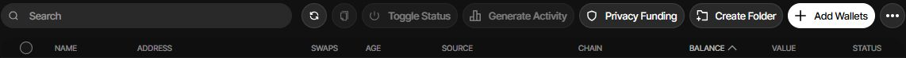
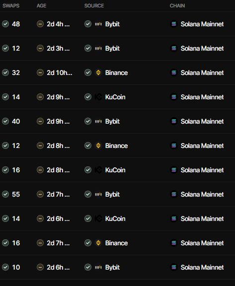
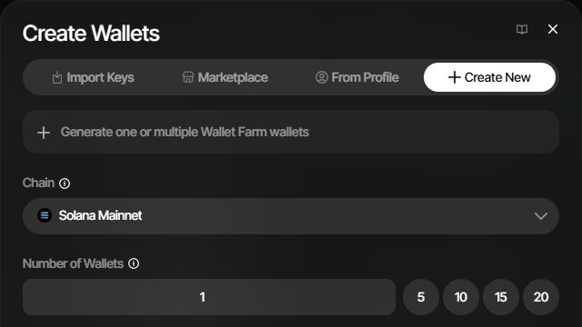
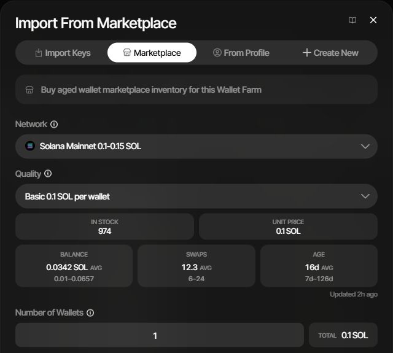
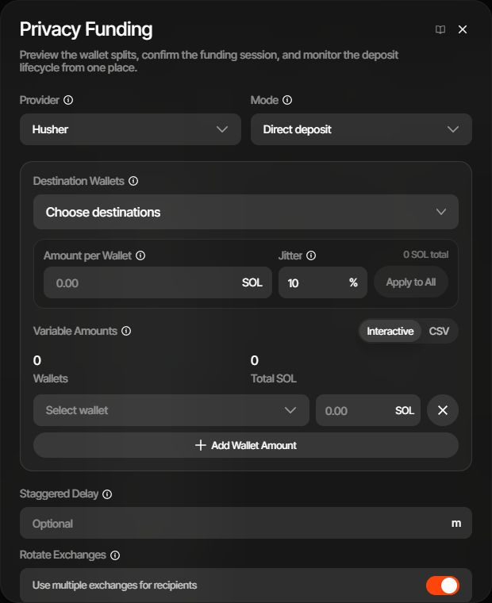
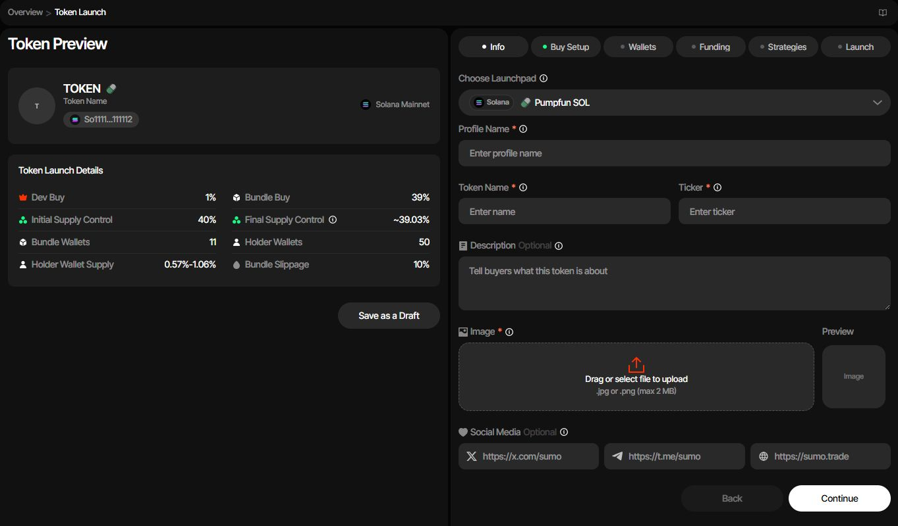
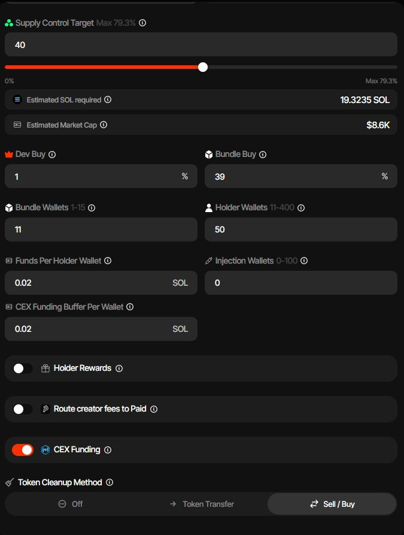
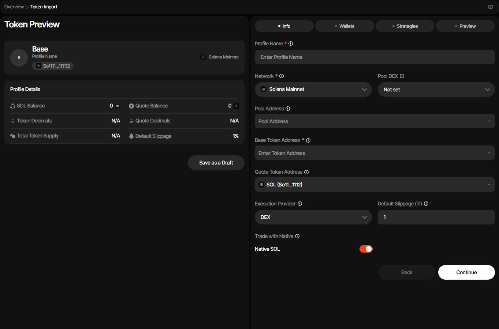
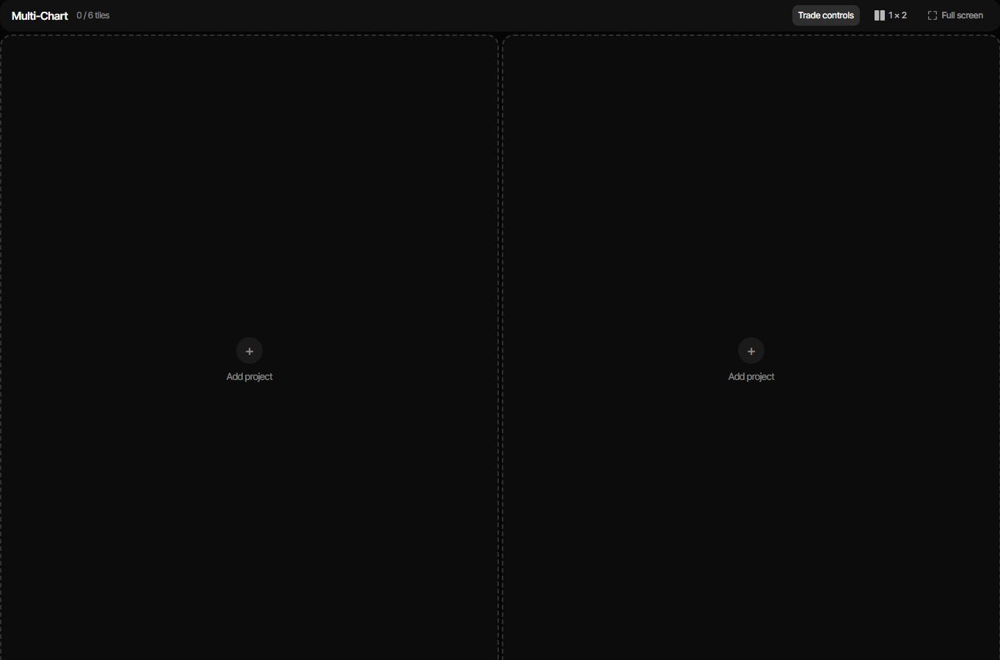

# Wallet Studio: Sumo capability parity PRD

Status: proposed product plan; no trading or deployment changes authorized by this document.

Research date: 5 October 2026, Australia/Sydney. Canonical repository: `D:/Shared/GitHub/wallet-studio`. Technical companion: [specs.md](./specs.md).

Build sequence, milestones and release acceptance: [implementation-plan.md](./implementation-plan.md).

## 1. Product objective

Expand Wallet Studio into a platform for preparing and managing wallet inventories, launching tokens, operating existing token projects, executing multi-wallet transactions, and monitoring results. Target the capabilities accessible in Sumo, with particular depth in its Token Launch and Wallet Farm workflows. Build our own implementation and interface; Sumo's backend, contracts, assets, and proprietary data are not available through this research.

The first useful release must connect a reusable wallet farm to a recoverable token-launch workflow. Full parity additionally requires trading strategies, treasury operations, market data, reporting, collaboration, commercial features, and numerous chain/protocol integrations. A launch form alone would not meet this objective.

Keep the current local Wallet Studio usable throughout development. Preserve its vault, transaction history, NFT campaigns, and existing curve/testnet workflows. Hosted team operations are a later delivery mode, not an assumption that the current desktop service can safely be exposed to the internet.

## 2. Evidence and research boundaries

Evidence labels used below:

- **UI**: observed in the signed-in Chrome application, including navigation, fields, dialogs, tables, and available actions. This confirms presentation, not successful execution.
- **DOC**: described in official Sumo documentation; the underlying behavior was not transaction-tested.
- **PLAN**: our proposed implementation or product decision.
- **OPEN**: incomplete, gated, conflicting, or not independently verified.

The walkthrough covered Wallet Farm, its wallet acquisition/activity/funding dialogs, Token Launch and launchpad selector, an existing project's trading and strategy controls, token import, dashboard, Multi-Chart, Rewards, Leaderboard, Settings, and Users. Public documentation supplied deeper launch, treasury, reporting, and integration behavior.

No wallets were created, private keys exported, funds moved, trades placed, strategies activated, launch submitted, or organization settings saved. Funding and later launch stages required creating launch wallets; that prompt was dismissed. Paid/gated tools and successful execution paths remain unverified. The original Chrome Wallet Farm page was restored. This plan deliberately excludes account-specific addresses, balances, identities, and project identifiers.

Sources can change. The inventory is a dated baseline of accessible capabilities, not a claim to know every private or newly released Sumo feature. A protocol's presence in a selector is not proof that every operation is currently functional.

Primary research entry points: [Sumo app](https://app.sumo.trade), [official documentation](https://docs.sumo.trade), and [public product site](https://www.sumo.trade).

Thirteen original Chrome screenshot crops are included in [section 11](#11-screenshot-evidence). They are dated visual evidence of the observed interface, with stable SS-01–SS-13 identifiers used by both documents. Crops exclude account identities, wallet addresses and settlement balances; no interface content was generated or altered.

## 3. Users, outcomes, and product boundaries

| User | Main job | Desired outcome |
|---|---|---|
| Project owner | Prepare and launch a token; oversee funds and access | Understand total commitments and recover interrupted work |
| Treasury operator | Fund, rebalance, swap, distribute, and collect assets | Every movement has an attributable intent and reconciled result |
| Trading manager | Configure strategies and shared presets | Bounded automation with clear wallet ownership and execution health |
| Trader | Operate approved projects and wallets | Fast execution within assigned permissions and limits |
| Analyst/client | Observe performance, holdings, and external wallets | Read-only, current, explainable information |
| Organization owner | Manage users, exports, fees, integrations | Enforce policies and review actions across the organization |

Success means a user can select wallets from the farm, plan a supported launch, inspect funding and irreversible actions, execute it, resume after interruption, and see the resulting project and receipts. Every later capability must use the same wallet identities and transaction journal.

Non-goals: copying Sumo branding or source; guaranteeing profit, anonymity, exchange-style limit execution, or atomicity where the chain does not provide it; presenting internally generated activity as independent demand; assuming purchased wallet keys are exclusively controlled by their seller. These are product accuracy constraints, not substitutes for the requested capabilities.

## 4. Existing product baseline

Repository inspection found a TypeScript/React application centered on Base, with encrypted local wallets, transaction planning, nonce handling, durable submission records, funding workflows, NFT campaigns, and local/testnet curve integrations. It is a useful execution foundation, not an existing multi-chain Sumo equivalent.

Material gaps:

- No farm membership/readiness model, marketplace, launchpad registry, persistent strategy scheduler, market-data platform, or hosted organization system.
- The current wallet cap is 200. Sumo workflows use different limits by operation; do not replace this with one larger global number.
- Existing address/transaction interfaces are EVM-specific. Solana and Tron require explicit chain-family support.
- Live token deployment currently rejects execution because no reviewed compiled artifact is available. The Solidity source alone does not establish deployment readiness.
- Direct submission to the Base sequencer does not establish an atomic private-bundle service.

The [technical specification](./specs.md#2-repository-baseline-and-reuse) identifies the existing modules and migration approach.

## 5. Capability inventory and requirements

Priority is delivery order, not removal from full parity. **P0** enables trustworthy wallet preparation and first launches; **P1** completes daily project operations; **P2** expands networks, integrations, teams, and commercial parity. Dependencies can move individual items earlier.

### 5.1 Workspace, profiles, and navigation

| ID | Capability and required behavior | Evidence | Priority |
|---|---|---|---|
| WS-01 | Searchable project sidebar, command palette, ordering, network/status filters, active/archive dashboard, stale-data indicators | UI | P0 |
| WS-02 | Import an existing token: network, base/quote assets, optional pool/DEX, execution provider, slippage, wallet and strategy setup, preview, draft | UI/DOC | P0 |
| WS-03 | Profile lifecycle: draft, launch preparation, active, archived; protect identity fields once live; clone reusable configuration without duplicating execution history | UI/DOC | P1 |
| WS-04 | Profile settings, organization presets, custom-token allowlists, funding diagnostics and explicit corrective actions | DOC | P1 |
| WS-05 | Archived-profile transfer between organizations, expiring claim codes, quotas, and explicit history/ownership semantics | DOC | P2 |
| WS-06 | Read-only client portal with selected sections and revocable access | DOC | P2 |

Import is a separate path from launch and must never deploy a replacement token. Profile cloning must explain that reusing a wallet reuses its actual funds and transaction history. Sources: [dashboard](https://docs.sumo.trade/getting-started/dashboard-overview), [profile settings](https://docs.sumo.trade/getting-started/profile-settings), and the live [import flow](https://app.sumo.trade/import-token).

### 5.2 Wallet Farm: highest-priority workflow

The farm is organization-level wallet inventory outside individual token projects. It is not a second copy of the funds held by a wallet.

Visual references: [SS-01 controls](./screenshots/sumo/01-farm-controls.jpg), [SS-02 readiness columns](./screenshots/sumo/02-farm-readiness.jpg), [SS-03 acquisition](./screenshots/sumo/03-wallet-acquisition.jpg), [SS-04 marketplace](./screenshots/sumo/04-wallet-marketplace.jpg), [SS-05 activity](./screenshots/sumo/05-farm-activity.jpg), and [SS-06 privacy funding](./screenshots/sumo/06-farm-privacy-funding.jpg).

| ID | Capability and required behavior | Evidence | Priority |
|---|---|---|---|
| WF-01 | In Progress and Ready views; colored folders and uncategorized inventory; search/sort/select; names, addresses, chain, balance/value, age, swaps, funding source, active state | UI/DOC | P0 |
| WF-02 | Aggregate counts, native balances, ranges/averages, activity and funding logs; balance refresh and source/freshness indicators | UI | P0 |
| WF-03 | Acquire wallets by generating, importing keys, copying from a profile, or purchasing marketplace inventory; assign a folder; optional seed-based generation | UI/DOC | P0 except marketplace P2 |
| WF-04 | Bulk activity plans with per-wallet variation, token selection, routing, gas reserves, preview, progress, pause, reconciliation, and bounded retries | UI/DOC; pause/reconciliation details PLAN | P0 |
| WF-05 | Provider-mediated funding with external deposit or managed source, destination allocations/CSV, jitter, staggering, exchange preferences, quote and status tracking | UI/DOC | P1 |
| WF-06 | Same-chain withdrawal/collection, cross-chain transfer entry point, proportional amount or sweep, fee reserves and destination permissions | UI/DOC | P1 |
| WF-07 | Move or copy wallets to a project; ready/in-progress selection; duplicate handling; preserve identity, custody and real history | DOC | P0 |
| WF-08 | Marketplace network/quality/stock, dated inventory statistics, unit/total price, settlement payment, atomic inventory reservation, custody disclosure | UI/DOC; reservation PLAN | P2 |
| WF-09 | Controlled key export with scoped permission, reauthentication, audit, and permanent exported/shared-custody label | UI/DOC | P1 |

**Readiness.** Sumo documents separate indicators: swaps are green at 10+, yellow at 5–9; funded age is green at 7+ days, yellow at 2–6; funding-source labels distinguish recognized services from unknown/wallet/contract sources. The live Ready list included younger wallets, so these colors do not establish its Ready-tab predicate. Our product must expose an explicit versioned readiness policy, its reasons, and unknown values. Never invent an old funding date for a new wallet. Source: [farm overview](https://docs.sumo.trade/wallet-farm/overview).

**Acquisition and membership.** Generation must show chain, count and destination folder before creation. Import validates keys without logging them. Copying a profile wallet retains the original membership; a wallet has at most one farm folder. Moving a farm wallet into a project removes farm membership only after the project assignment succeeds. Copying keeps both memberships, with the same address and spendable balance. Duplicate selection needs clear move/copy handling. Sources: [add wallets](https://docs.sumo.trade/wallet-farm/add-wallets), [import to profile](https://docs.sumo.trade/wallet-farm/import-to-profile).

**Activity controls.** The observed dialog includes swap range, amount range, dust percentage, delay, provider, batch size, and trending/custom tokens. Documentation describes same-chain jobs of up to 250 wallets, a token pool of up to 25, and a buy followed by a sell using confirmed holdings. It distinguishes provider routes, direct-pool routes, alternate-route recovery, token quarantine after sell problems, and a cleanup-only mode. Our UI must distinguish pairs from individual swap legs and budget the complete job before execution. Source: [generate activity](https://docs.sumo.trade/wallet-farm/generate-activity).

**Funding.** The live Husher dialog supports per-wallet allocations, CSV, jitter, delay, exchange rotation and allowed exchanges. Provider states, deadlines, fees, refunds and actual receipts must be visible. Privacy wording must describe the route and provider without promising unlinkability. Sources: [privacy funding](https://docs.sumo.trade/wallet-farm/privacy-funding), [farm withdrawal](https://docs.sumo.trade/wallet-farm/withdraw).

**Marketplace.** Quality labels are not independently verified guarantees. Observed inventory statistics did not always align with documentation's headline quality descriptions. Display measured ranges and their observation time, provider provenance, delivery terms, and whether historical key holders might retain access. Source: [wallet marketplace](https://docs.sumo.trade/wallets/wallet-marketplace).

### 5.3 Token Launch: highest-priority workflow

| ID | Capability and required behavior | Evidence | Priority |
|---|---|---|---|
| LN-01 | Six-stage wizard: Info, Buy Setup, Wallets, Funding, Strategies, Launch; save/resume drafts and a persistent cost/supply preview | UI/DOC | P0 |
| LN-02 | Versioned launchpad/network/quote catalog that renders only supported fields, wallet roles, limits and execution modes | UI/DOC; versioning PLAN | P0 |
| LN-03 | Metadata/image validation; token parameters, supply target or quote commitment, jitter, slippage, taxes/rewards and tips where supported | UI/DOC | P0 |
| LN-04 | Role assignment: developer/creator, bundle buyers, holders, injection, snipers, fee/tax recipients and protocol-specific roles | UI/DOC | P0 |
| LN-05 | Per-wallet funding plan: purchases, liquidity, quote conversion, gas/rent, tips, buffers, provider/platform fees; deposit/distribute/check balances | DOC | P0 |
| LN-06 | Simulate and validate a frozen launch plan; explain term drift and irreversible authority/fee decisions; require fresh review when it changes | DOC; review rules PLAN | P0 |
| LN-07 | Durable launch execution with per-stage receipts, truthful atomicity boundaries, partial-success recovery, and post-launch profile activation | DOC; recovery contract PLAN | P0 |
| LN-08 | Post-launch redistribution: off, direct token transfer, or sell/buy where supported; funding/cleanup logs and resumable failures | UI/DOC | P1 |
| LN-09 | Optional starter strategies, reusable presets, and explicit activation state after launch | UI/DOC | P1 |
| LN-10 | Creator/LP fee claims, recipient changes, liquidity locking, authority revocation and renunciation where the selected protocol permits them | DOC | P1/P2 by adapter |
| LN-11 | Bundle-plus-snipe or graduation modes with separately explained execution and funding commitments | UI/DOC | P1/P2 by adapter |
| LN-12 | Every launch choice in the dated matrix below receives an adapter or a tracked, visible unsupported status until qualified | UI/OPEN | P2 completion gate |

Sources for the common flow: [launch guide](https://docs.sumo.trade/getting-started/launch-new-token) and the live [launch wizard](https://app.sumo.trade/token-launch).

Visual references: [SS-07 metadata and preview](./screenshots/sumo/07-launch-info.jpg), [SS-08 allocation](./screenshots/sumo/08-launch-buy-setup.jpg), [SS-09 funding/rewards/cleanup](./screenshots/sumo/09-launch-funding-cleanup.jpg), [SS-10 wallet roles](./screenshots/sumo/10-launch-wallet-roles.jpg), and [SS-11 creation prerequisite](./screenshots/sumo/11-launch-wallet-creation-gate.jpg). SS-11 explains why funded execution stages were not entered during research.

**Observed Pump example, not recommended defaults.** The UI showed a 40% supply target, 1% developer share, 11 bundle wallets, 50 holder wallets, 10% slippage, CEX funding, holder-reward/Paid controls, cleanup selection, and separate launch/cleanup tips. Documentation describes SOL, USDC and custom quotes; role capacities vary by launch mode. Quote acquisition must retain SOL for network costs. Holder rewards and the alternate fee route can be mutually exclusive and irreversible. Treat protocol terms as revalidated adapter data, not constants copied from screenshots. Source: [Pump launch](https://docs.sumo.trade/launch-tokens/pumpfun-launch).

**Different execution models need different screens.** Base Uniswap launches are documented as staged deployment, pool/liquidity preparation, purchases while trading is gated, opening and finalization. Ethereum Uniswap uses a different private-submission sequence. Meteora distinguishes freeze-bundle and simple-pool modes. Robinhood SushiSwap describes a single creator transaction whose frozen input is ETH commitment, while estimated token share can move. Our product must explain these differences before users fund wallets. Sources: [Base Uniswap](https://docs.sumo.trade/launch-tokens/uniswap-base-launch), [Ethereum Uniswap](https://docs.sumo.trade/launch-tokens/uniswap-eth-launch), [Meteora](https://docs.sumo.trade/launch-tokens/meteora-dammv2-launch), [Robinhood SushiSwap](https://docs.sumo.trade/launch-tokens/robinhood-sushi-launch).

### 5.4 Launchpad parity matrix

The live selector exposed **31 choices across eight chain labels**. Counts below count SOL/USDC/custom or V2/V3 separately where the selector did. These are UI observations, not executed launches. Source links document related behavior; a link alone does not certify our integration.

| Chain | Observed choices | Count | Implementation family and qualification work |
|---|---|---:|---|
| Solana | Pumpfun SOL, Pumpfun USDC, Pumpfun Custom | 3 | Bonding curve; quote/mode-specific limits, migration, private submission and cleanup; [guide](https://docs.sumo.trade/launch-tokens/pumpfun-launch) |
| Solana | Meteora DAMM v2 SOL, Meteora DAMM v2 USDC | 2 | Pool launch with freeze/simple variants; [guide](https://docs.sumo.trade/launch-tokens/meteora-dammv2-launch) |
| Solana | BONK.fun | 1 | LaunchLab variant; [guide](https://docs.sumo.trade/launch-tokens/bonkfun-launch) |
| Solana | America.Fun | 1 | Token-2022/DBC and USD1 quote; [guide](https://docs.sumo.trade/launch-tokens/americafun-launch) |
| Solana | Memoo | 1 | LaunchLab variant with its own funding terms; [guide](https://docs.sumo.trade/launch-tokens/memoo-launch) |
| Solana | StonkFun | 1 | Quote catalog and protocol-specific curve; deep adapter discovery pending; [guide](https://docs.sumo.trade/launch-tokens/stonkfun-launch) |
| Solana | meme.fun | 1 | UI verified; public guide retrieval failed; execution model OPEN |
| Ethereum | Uniswap V2 | 1 | Pool launch and private buyer submission; [guide](https://docs.sumo.trade/launch-tokens/uniswap-eth-launch) |
| Ethereum | moto.fun | 1 | Protocol curve, separate graduation and restricted cleanup; [guide](https://docs.sumo.trade/launch-tokens/motofun-ethereum-launch) |
| BNB | PancakeSwap V2 | 1 | EVM pool launch; confirm current contracts and supported controls; [guide](https://docs.sumo.trade/launch-tokens/pancakeswap-v2-bsc-launch) |
| BNB | Four.meme | 1 | Provider-generated curve creation parameters; [guide](https://docs.sumo.trade/launch-tokens/fourmeme-bsc-launch) |
| BNB | Flap | 1 | Curve/graduation and configurable tax variants; [guide](https://docs.sumo.trade/launch-tokens/flap-bsc-launch) |
| Base | Uniswap V2, Uniswap V3 | 2 | Staged pool launch; V2/V3 authority and tax differences; [guide](https://docs.sumo.trade/launch-tokens/uniswap-base-launch) |
| Base | Aerodrome | 1 | Classic volatile-pool launch; [guide](https://docs.sumo.trade/launch-tokens/aerodrome-base-launch) |
| Robinhood | Uniswap V2, Uniswap V3 | 2 | Staged pool launch with chain-specific cleanup; [guide](https://docs.sumo.trade/launch-tokens/robinhood-uniswap-launch) |
| Robinhood | SushiSwap | 1 | Single creator-transaction launchpad flow; [guide](https://docs.sumo.trade/launch-tokens/robinhood-sushi-launch) |
| Robinhood | Pons V2 | 1 | Native bonding-curve adapter; [guide](https://docs.sumo.trade/launch-tokens/robinhood-pons-v2-launch) |
| Robinhood | Flap | 1 | Separate deployment/configuration from BNB; [guide](https://docs.sumo.trade/launch-tokens/robinhood-flap-launch) |
| Robinhood | LetsCash | 1 | Protocol discovery and conformance required; [guide](https://docs.sumo.trade/launch-tokens/robinhood-letscash-launch) |
| Robinhood | Lunch.fun | 1 | Protocol discovery and conformance required; [guide](https://docs.sumo.trade/launch-tokens/robinhood-lunch-fun-launch) |
| Robinhood | Pools.trade | 1 | Protocol discovery and conformance required; [guide](https://docs.sumo.trade/launch-tokens/robinhood-pools-trade-launch) |
| Robinhood | Balloon.club | 1 | UI verified; detailed workflow and contracts OPEN |
| Arc | Uniswap V3 | 1 | UI verified; chain/quote/deployment details OPEN |
| Stable | Uniswap V3 | 1 | Chain-specific native/quote semantics; [guide](https://docs.sumo.trade/launch-tokens/stable-uniswap-launch) |
| Ink | Uniswap V2, Uniswap V3 | 2 | UI verified; deployed contracts, routing and limits OPEN |
| **Total** | | **31** | |

Launchpad parity includes metadata, roles, funding, simulation, execution, receipts and recovery; listing a name in a menu does not count as completion.

### 5.5 Trading and strategies

| ID | Capability and required behavior | Evidence | Priority |
|---|---|---|---|
| TR-01 | Manual buy/sell, quick presets, custom amounts, max, conversion and swap; wallet/group/all scope, slippage and execution preferences | UI/DOC | P0 for first adapters |
| TR-02 | Counter strategy: react to external trades using trigger range, direction, capture percentage, delay, budget and market-cap guards | UI/DOC | P1 |
| TR-03 | DCA: scheduled buys/sells, interval, amount/time variation, budgets/cycle limits and available-balance behavior | UI/DOC | P1 |
| TR-04 | Limit strategy: repeatedly execute within a market-cap window with cadence and budget controls; label this distinction explicitly | UI/DOC | P1 |
| TR-05 | Create inactive, activate/pause/archive, edit while paused, clone across compatible profiles, reuse organization presets, retain history | UI/DOC | P1 |
| TR-06 | Multi-wallet supply acquisition: parallel/wave plans, allocation modes, price protection, gas reserves and fill preview | DOC | P1 |
| TR-07 | Impact calculator: estimated price/market-cap movement and asset flows, including modeled outside flow | UI/DOC | P1 |

The live strategy-create dialog exposed Counter, DCA and Limit Order. Do not silently invent Grid support because it is mentioned elsewhere. Source semantics: [strategy lifecycle](https://docs.sumo.trade/strategies/overview), [counter](https://docs.sumo.trade/strategies/counter-trade), [DCA](https://docs.sumo.trade/strategies/dca), [limit orders](https://docs.sumo.trade/strategies/limit-orders), [instant trade](https://docs.sumo.trade/strategies/instant-trade), [snipe](https://docs.sumo.trade/strategies/snipe-token-supply), [impact calculator](https://docs.sumo.trade/strategies/impact-calculator).

### 5.6 Treasury and wallet operations

| ID | Capability and required behavior | Evidence | Priority |
|---|---|---|---|
| TY-01 | Asset dashboard, native/quote/project-token balances, wallet groups, excluded/archived balances and fee claims | UI/DOC | P0/P1 |
| TY-02 | Native/token withdrawals, single or CSV destinations, collection, sweeping and allocation modes with gross/net previews | DOC | P1 |
| TY-03 | Airdrop from address list or supported holder snapshot; filters, deduplication, source balance checks, batching and partial-result recovery | UI/DOC | P1 |
| TY-04 | Treasury/native-stable/custom-token swaps, allowlists, provider comparison, pro-rata/equal/fixed allocations where supported | DOC | P1 |
| TY-05 | Cross-chain swaps, route/provider selection, source legs and separate destination settlement tracking | UI/DOC | P2 |
| TY-06 | Privacy cashout, multi-source/destination allocations, exchange preferences and provider/refund lifecycle | DOC | P2 |
| TY-07 | Full or partial wallet rotation; transfer assignments only under explicit rules after successful asset movement | DOC | P1 |
| TY-08 | Token cleanup via transfer or sell/buy, allocation variation, top-ups, receipts and recovery | UI/DOC | P1 |
| TY-09 | Burn, liquidity lock, wrap/unwrap, creator/LP fee claims and supported authority actions; irreversible consequences visible | DOC | P1/P2 |

Airdrop documentation describes up to 50,000 recipients, much larger than interactive wallet-management limits. The plan therefore needs resumable jobs, not a giant synchronous browser request. Sources: [treasury](https://docs.sumo.trade/treasury/treasury-dashboard), [withdrawals](https://docs.sumo.trade/treasury/withdraw), [airdrops](https://docs.sumo.trade/treasury/airdrops), [treasury swaps](https://docs.sumo.trade/treasury/stable-swap), [custom swaps](https://docs.sumo.trade/treasury/custom-swap), [bridging](https://docs.sumo.trade/treasury/cross-chain-swap), [cashout](https://docs.sumo.trade/treasury/privacy-cashout), [rotation](https://docs.sumo.trade/treasury/swap-wallets), [cleanup](https://docs.sumo.trade/treasury/token-cleanup), [liquidity locks](https://docs.sumo.trade/treasury/lock-liquidity), [burn](https://docs.sumo.trade/treasury/burn), [wrap/unwrap](https://docs.sumo.trade/treasury/wrap-unwrap). Burn/wrap detailed mechanics require adapter discovery.

### 5.7 Market data, analysis, and reporting

| ID | Capability and required behavior | Evidence | Priority |
|---|---|---|---|
| AN-01 | Live charts, timeframes, price/market-cap and quote/USD modes, drawings, overlays, fullscreen and snapshots; pool/migration information | UI/DOC | P1 |
| AN-02 | Trade feed with source tags, own/external/MEV heuristics, maker drilldown, transaction links and filters; volume/PnL with explicit scope | UI/DOC | P1 |
| AN-03 | Multi-Chart board, project tiles, layout and optional trade controls; live UI showed a six-tile capacity | UI | P1 |
| AN-04 | Surveillance wallet groups, baselines, balance deltas, outward-transfer descendants, stopping rules, activity and CSV import/export | UI/DOC | P2 |
| AN-05 | Performance and execution insights, strategy attribution, fees, success rates, retries and submission/confirmation latency | UI/DOC | P1 |
| AN-06 | Holder distribution and graph analysis, clustering/history, saved analysis and managed-wallet matching | DOC | P2 |
| AN-07 | Notifications and trade/treasury/audit/launch logs with filtering, export, read state and failure detail | UI/DOC | P0 foundation; P1 full UI |

Chart denominators and own-wallet attribution affect the meaning of every number. Unknown price data must appear as unknown, not zero. A submitted transaction, a failed transaction, and a request that never submitted must have different statuses. Sources: [live trading](https://docs.sumo.trade/reporting/live-trading), [surveillance](https://docs.sumo.trade/reporting/surveillance), [insights](https://docs.sumo.trade/reporting), [graph analysis](https://docs.sumo.trade/reporting/bubblemaps-analysis), [notifications](https://docs.sumo.trade/reporting/profile-notifications), [trade logs](https://docs.sumo.trade/reporting/trade-logs), [treasury logs](https://docs.sumo.trade/reporting/treasury-logs), [audit logs](https://docs.sumo.trade/reporting/audit-logs).

### 5.8 Organization, integrations, and commercial features

| ID | Capability and required behavior | Evidence | Priority |
|---|---|---|---|
| AC-01 | Authentication, account recovery, sessions, 2FA, profile/security/personalization settings | UI/DOC | P0 local protection; P2 hosted identity |
| AC-02 | Organization invitations, Admin/Trading Manager/Trader/Analyst roles, deactivation, project permissions and protected owner actions | UI/DOC; exact matrix PLAN | P2 |
| AC-03 | Key-export policy, timed grants, reauthentication, custody labels, no secrets in logs or ordinary APIs | DOC | P1 local; P2 team grants |
| AC-04 | Settlement balances and ledger, deposits/withdrawals, launch tickets, versioned fees, cashback/referral accrual and claims | UI/DOC | P2 |
| AC-05 | Referral codes, quotas/perks/ranks, rolling-volume statistics and configurable eligibility | UI/DOC | P2 |
| AC-06 | Leaderboard, opt-in identity/social/project highlights and privacy controls | UI | P2 |
| AC-07 | Telegram linking, alerts and supported controls; external market/graph/funding/execution integrations | DOC | P2 |
| AC-08 | Gated feature discovery: Token X-Ray, Snipe Deck references, Grid mentions, and any newly visible options | UI/OPEN | P2 discovery gate |

The live Rewards view exposed settlement labels for Solana, Ethereum, BSC, Stable, HyperEVM, Ink, Arc, Base, Robinhood and Tron. This is broader than the launch selector and some docs. Features must be enabled per chain and operation, not through one global supported-chains checkbox.

Sources: [users](https://docs.sumo.trade/account/user-management), [settings](https://docs.sumo.trade/account/user-settings), [export policy](https://docs.sumo.trade/account/key-export), [rewards](https://docs.sumo.trade/account/rewards), [referrals](https://docs.sumo.trade/account/referrals), [Telegram](https://docs.sumo.trade/integrations/telegram-bot), [other integrations](https://docs.sumo.trade/integrations/other-integrations).

### 5.9 Integration coverage beyond launch

The full target includes the following documented families, subject to network-specific qualification:

- Solana execution: Pump/PumpSwap, Raydium pool/LaunchLab variants, Orca Whirlpool, Meteora pool/curve variants; Jupiter, DFlow and OKX routing.
- EVM execution: applicable Uniswap V2/V3/V4, SushiSwap, PancakeSwap, Aerodrome, and launchpad-specific pools; applicable 0x and Uniswap API routing.
- Tron: SunSwap/SunPump-related trading paths; do not infer token-launch support.
- Native RPC/private submission, metadata storage, token/price discovery, charts, holder analysis, cross-chain routing, privacy funding, and wallet inventory suppliers.

Network scope and provider access must be validated against primary protocol specifications before implementation. Sources: [chains](https://docs.sumo.trade/integrations/supported-chains), [DEXes](https://docs.sumo.trade/integrations/supported-dexes), [aggregators](https://docs.sumo.trade/integrations/supported-aggregators). Specific deployment addresses and commercial API entitlements were not verified in this research.

## 6. Core user journeys and acceptance criteria

### Journey A: prepare a farm and allocate it to a project

1. Create a folder and generate/import/select wallets for one chain.
2. See balances and independent age/activity/source indicators, including unknown data.
3. Review and fund a bounded activity plan; inspect estimated fees and maximum spend.
4. Follow each buy/sell leg, recover an interrupted job, and inspect remaining token dust.
5. Review readiness reasons and copy or move selected wallets into a project or launch role.

Acceptance: no duplicate keys or double-counted portfolio value; failed imports are isolated and do not expose keys; job restart cannot repeat an already confirmed leg; insufficient funds stop affected work with a reason; readiness uses confirmed evidence; membership changes never pretend to transfer funds. Covers WF-01–WF-07, AN-07, AC-03.

### Journey B: launch a token

1. Select a qualified chain/launchpad and enter metadata.
2. Choose supported buy mode and desired allocation; inspect actual quote commitments.
3. Assign role-compatible wallets from the farm or other acquisition paths.
4. Save a versioned plan and fund the individual shortfalls, retaining fee reserves.
5. Configure optional inactive strategies; simulate and review the final plan.
6. Execute, reconcile each stage, perform applicable cleanup, and enter the live project.

Acceptance: live terms are checked again before signing; each wallet's funding requirement is explainable; incompatible rewards/taxes/modes are rejected; simulation limitations are stated; a timeout does not become a second deployment; partial success displays actual deployed assets and pending work; activation and strategy starts follow explicit policy. Covers LN-01–LN-11.

### Journey C: operate an existing token

Import a token/pool, attach wallets, perform a reviewed manual trade, configure a budgeted strategy, monitor execution and holdings, distribute or collect assets, then archive the project. Acceptance: importing never deploys; stopped strategies create no new intents; previously submitted transactions remain monitored; own activity is attributable; archival does not hide pending settlement. Covers WS-02–WS-04, TR-01–TR-07, TY-01–TY-09, AN-01–AN-07.

### Journey D: manage a team and commercial account

Invite users, apply server-enforced permissions, grant an expiring key-export entitlement, review audit events, manage settlement/tickets/claims and optionally publish leaderboard details. Acceptance: read-only users cannot sign; users cannot expand their own privileges; exports are audited without recording secrets; accrual/claims cannot double-spend; public identity is opt-in. Covers AC-01–AC-07, WS-05–WS-06.

## 7. Product design and quality requirements

- Keep persistent wallet/chain/project context visible. Every irreversible action shows network, destinations, asset, expected amount, maximum cost and recoverability.
- Preview before commitment; display blockers separately from warnings. Plan changes invalidate dependent previews and show why.
- Long jobs remain visible after navigation and reconnect. Display completed, pending, failed and uncertain units separately.
- Dense tables need sticky identity columns, bulk-selection scope, filter summaries and accessible keyboard controls. Clear selection when changing incompatible chain context.
- Farm names, groups and folders organize wallet identities; they must not imply custody separation.
- Default slippage, tips and randomness are conservative product settings, not copied competitor defaults. Show their cost implications.
- Provide empty, loading, stale, offline, insufficient-funds, provider-unavailable, partially-complete and permission-denied states.
- Desktop is the first execution surface. Smaller screens support review and monitoring; compressed layouts must not hide signing-critical fields.
- Original branding and UI components; external chart/graph/provider assets require their own integration rights.

## 8. Delivery plan

Estimates are planning ranges for a small team of roughly four to six engineers plus product/design and dedicated security review. They are not a delivery commitment. Vendor access, protocol review and external audits can dominate elapsed time; phases overlap only after shared contracts stabilize.

| Phase | Indicative effort window | Deliverable | Exit gate |
|---|---|---|---|
| 0: evidence and foundations | 2–3 weeks | Capability registry, permissions model, durable jobs, migration design, simulated providers | Existing functionality preserved; representative recovery tests pass |
| 1: wallet farm | 4–6 weeks | Folders, readiness, import/generate, memberships, direct funding, bounded activity and logs on initial networks | Journey A passes under interruption and concurrent jobs |
| 2: first complete launches | 6–10 weeks | Base pool-launch adapter and Solana Pump adapter, full six-stage workflow, reviewed artifacts and recovery | Journey B on test/fork environments; external review before production enablement |
| 3: operations | 6–10 weeks | Trading/strategies, treasury, chart/feed, insights, redistribution and fee workflows | Journey C; reconciliation and attribution tests pass |
| 4: adapter expansion | 10–18+ weeks, in waves | Remaining launch matrix, trading networks, marketplace, privacy/cross-chain providers | Per-adapter conformance and funded rehearsal; no menu-only parity |
| 5: hosted/commercial parity | 6–10 weeks, partly parallel | Hosted organizations, roles, portals, rewards/referrals, Telegram, surveillance/graphs | Journey D; tenant isolation, signer and ledger review |
| 6: parity audit | 2–4 weeks after integrations | Resolve gated features and discrepancies; rerun dated capability matrix | Every requirement shipped, explicitly deferred with owner, or demonstrably unsupported by a dependency |

Recommend Base first for reuse of existing execution code, with Solana support started during foundations so the farm and Pump workflow are not forced into EVM abstractions. Full parity is a multi-quarter program; narrow first-release scope should not be mislabeled as full parity.

Suggested workstreams are product/UI, wallet/signing and durable execution, launch/protocol adapters, market data/strategies, and hosted integrations. These are staffing proposals, not agents or tasks created by this research.

## 9. Measurement and release gates

These are proposed targets, not measured current performance:

- Zero unexplained duplicate financial intents across crash/retry tests.
- Every submitted transaction has a recoverable identifier and reconciled or explicitly uncertain status.
- No secret values in logs, exports of ordinary data, error responses or analytics.
- Launch preview explains 100% of required funding categories; rounding conserves allocation totals.
- Farm membership and global balance views never double-count one address on one chain.
- Common local table interactions remain responsive at 10,000 inventory records using pagination/virtualization; qualify separately from signing limits.
- Activity batches of 250 and airdrop lists of 50,000 can be resumed from durable checkpoints on qualified adapters.
- API/UI latency targets and provider availability budgets are specified in the technical plan; chain confirmation time is measured separately.
- Complete P0 journeys before adding commercial features; production adapters require qualification, current contract identification, and rehearsed failure recovery.

## 10. Open findings, conflicts, and decisions

| Finding | Evidence | Required resolution |
|---|---|---|
| Launch allocation fee differs | Public site/general launch guide say 0.25%; fee/reward docs say 0.5% | Version our own fee schedule; confirm current competitor quote only if numerical parity is needed |
| Stable-swap/withdrawal fees differ | Marketing and fee table indicate free categories; operation guides describe charges/exceptions | Show per-operation quotes and distinguish platform, network and provider fees |
| Network coverage differs | UI includes Arc/Ink and ten settlement labels; docs list fewer networks | Maintain independent operation-level capabilities |
| Ready predicate is unclear | Live Ready rows do not all meet green age threshold | Product-owned transparent readiness policy; do not copy a guessed predicate |
| Marketplace quality ambiguity | Observed aggregate range differs from headline description | Contractual inventory criteria, measured history and refunds must be defined |
| Gated tools incomplete | Token X-Ray locked in Rewards; Snipe Deck/Grid referenced elsewhere | Obtain authorized feature access/demo before claiming parity or writing detailed behavior |
| Launch workflow partly gated | Later wizard steps require actual wallet creation | Qualify with owned test accounts/funds later; current design uses documentation |
| New launch choices lack verified mechanics | Arc, Ink, Balloon.club, meme.fun and some other adapters | Protocol discovery tickets with acceptance evidence before implementation |
| Security architecture is a vendor claim | Docs describe envelope encryption and alternative signer/KMS arrangements | Independently design/review our signer; do not claim Sumo internals were verified |
| Snipe protection language is inconsistent | Documentation mixes private routing claims and RPC paths/premium descriptions | Define measurable slippage/price-protection semantics per route |
| Hosted operation is not yet selected | Current product is a local service | Ship local-first; require a separate hosted deployment design before enabling remote access |

Fee sources: [public site](https://www.sumo.trade), [platform fees](https://docs.sumo.trade/platform-fees), [rewards](https://docs.sumo.trade/account/rewards), [treasury swap](https://docs.sumo.trade/treasury/stable-swap), [farm withdrawal](https://docs.sumo.trade/wallet-farm/withdraw). Security source: [security and encryption](https://docs.sumo.trade/wallets/security-encryption).

Full-parity sign-off requires a fresh UI walkthrough, an updated operation-by-chain matrix, and successful qualification evidence. Unknown capabilities remain visible backlog items rather than assumed implementations.

## 11. Screenshot evidence

Captured from the existing signed-in Chrome Sumo session on 5 October 2026. Files are stored in `docs/screenshots/sumo/`. Each image is an original browser screenshot cropped at capture time to exclude identifying account details. No synthetic replacements, DOM edits, generated mockups or post-capture image retouching were used. Displayed settings and prices are observations at capture time, not recommended defaults or guaranteed current terms.

Screenshots establish visible controls only. They do not prove backend execution, source attribution accuracy, wallet quality, privacy guarantees or launch success. Lower controls outside the captured viewport are not implied to be visible. The launchpad matrix was established from the selector's inspected options; these screenshots do not show all 31 options.

### SS-01 — Wallet Farm controls and table schema

Source: [Wallet Farm](https://app.sumo.trade/wallet-farm). Requirements: WF-01, WF-02, WF-04–WF-06. Narrow crop shows search, refresh, status/activity/funding actions, folder/wallet creation, additional actions, and column headings. Activity/status actions are disabled because no wallets were selected in this capture.

### SS-02 — Separate activity, age and source indicators

Source: Wallet Farm, Ready view. Requirements: WF-01, WF-02. Crop excludes wallet identities and balances while retaining the separate Swaps, Age, Source and Chain columns. Yellow age indicators coexist with green activity/source indicators; this supports keeping dimensions independent rather than inferring a single undocumented readiness formula.

### SS-03 — Wallet acquisition paths

Source: Wallet Farm → Add Wallets → Create New. Requirement: WF-03. Shows Import Keys, Marketplace, From Profile and Create New tabs plus chain/count controls. The lower folder and seed controls are outside this crop. Nothing was generated or imported.

### SS-04 — Marketplace inventory and pricing

Source: Wallet Farm → Add Wallets → Marketplace. Requirement: WF-08. Shows network, quality, stock, unit price, inventory balance/activity/age statistics, freshness and total purchase price. Inventory balances describe offered stock; the user's settlement panel and folders are excluded. No purchase was made.

### SS-05 — Activity job configuration

Source: Wallet Farm → Generate Activity. Requirement: WF-04. One wallet was selected only to inspect the dialog. Shows swap and amount ranges, dust, delay, execution provider, batch size and token selection. The form was closed without confirmation; selection was cleared.

### SS-06 — Privacy funding setup

Source: Wallet Farm → Privacy Funding. Requirement: WF-05. Visible portion shows provider/mode, destination selection, per-wallet allocation, jitter, interactive/CSV input, delay and exchange rotation. The lower allowed-exchange/preview controls are outside the crop. Destinations remain unselected; no funding session was submitted.

### SS-07 — Launch metadata and persistent preview

Source: [Token Launch](https://app.sumo.trade/token-launch), Info stage. Requirements: LN-01–LN-03. Shows the six-stage navigation, launchpad choice, metadata/image/social inputs, draft action and persistent estimated launch summary. The displayed token/address is an application placeholder, not a launched token or user wallet.

### SS-08 — Launch allocation and role counts

Source: Token Launch → Buy Setup, Pumpfun SOL. Requirements: LN-03–LN-05, LN-11. Shows Bundle versus Bundle + Snipe, target allocation, estimated funding/market cap, developer/bundle split and wallet counts. Estimates are illustrative application output and were not funded or executed.

### SS-09 — Funding, reward routing and cleanup choices

Source: Token Launch → Buy Setup, lower visible controls. Requirements: LN-03, LN-05, LN-08. Shows per-role funding/buffer inputs, holder rewards, creator fee routing, CEX funding and cleanup methods. Advanced slippage/tip fields below the viewport are not shown in this image.

### SS-10 — Wallet roles before acquisition

Source: Token Launch → Wallets. Requirement: LN-04. Shows role explanations, required/assigned counts and separate acquisition actions for developer, bundle and holder wallets. No wallets were created for this draft.

### SS-11 — Wallet creation and count-lock prerequisite

Source: attempting Token Launch → Funding before assigning wallets. Requirements: LN-04–LN-06. This dialog warns that wallet counts become fixed after confirmation. It was dismissed. It is evidence of a prerequisite, not evidence of the subsequent funding or execution screens.

### SS-12 — Existing-token import

Source: [Token Import](https://app.sumo.trade/import-token). Requirement: WS-02. Shows the separate four-stage import path, network/pool/base/quote/provider inputs, slippage and native-trading toggle. Fields remain unsubmitted; preview balances are empty-form placeholders.

### SS-13 — Multi-Chart board

Source: [Multi-Chart](https://app.sumo.trade/multi-chart). Requirement: AN-03. Shows the empty board, 0/6 tile indicator, layout selector, trade-control toggle, fullscreen and add-project actions. This confirms board controls, not populated charts or trade execution.

