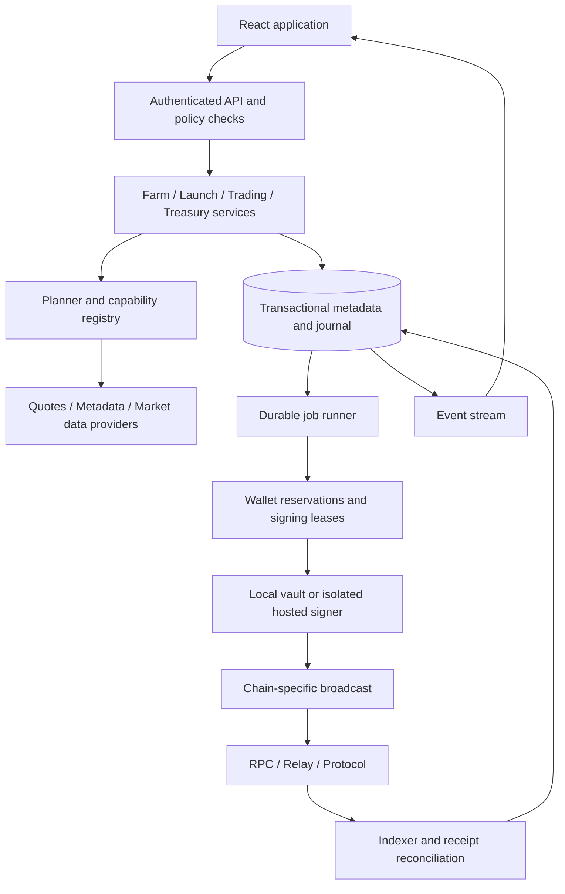
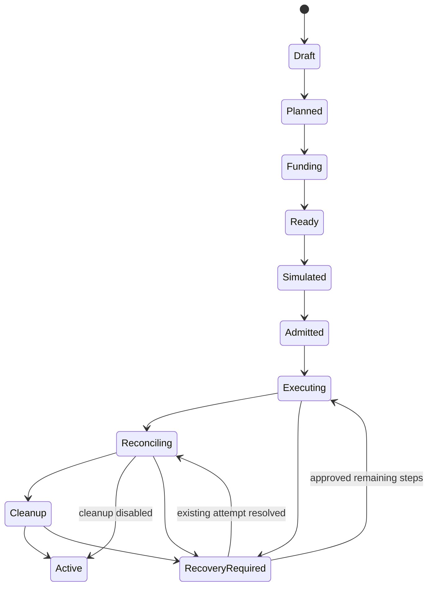
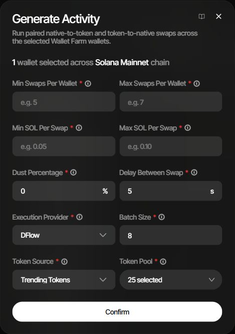
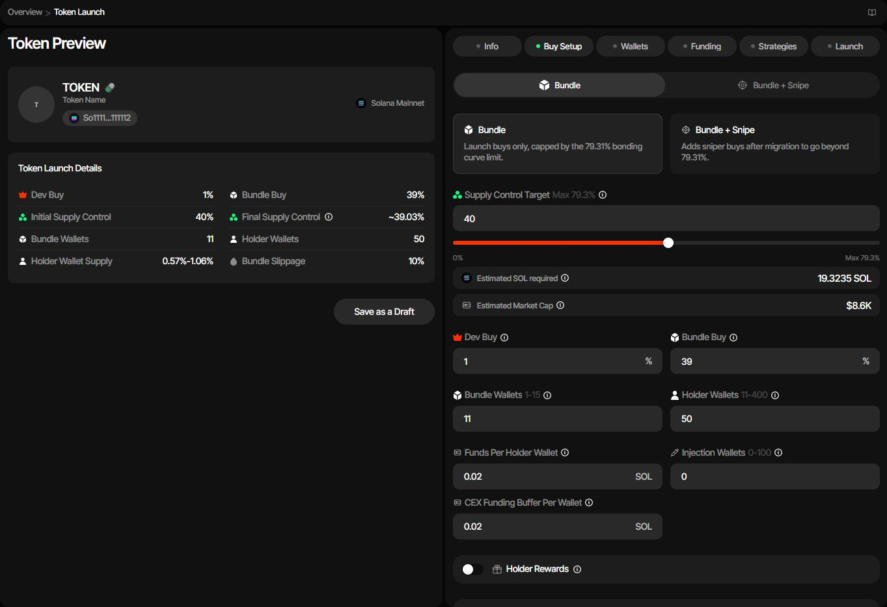
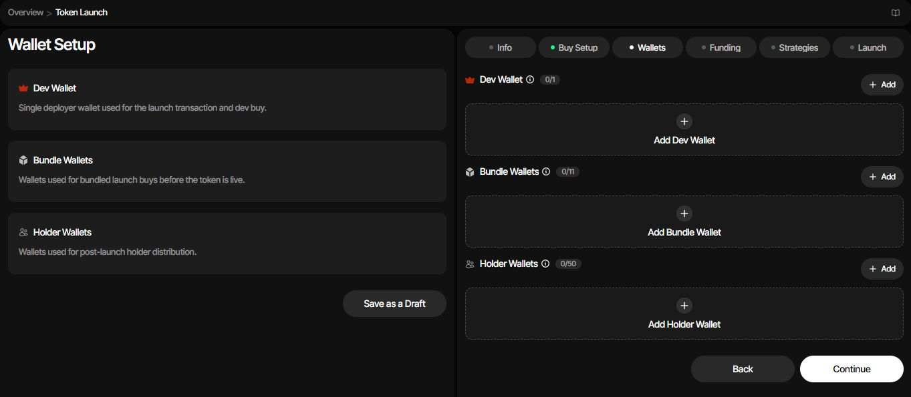
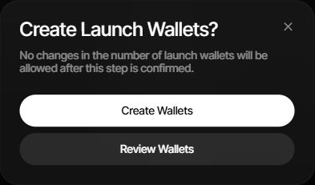

# Wallet Studio: Sumo parity technical specification

Status: proposed architecture and implementation backlog, not implemented functionality.

Research baseline: 5 October 2026. Repository: `D:/Shared/GitHub/wallet-studio`. Product scope and evidence: [prd.md](./prd.md). Requirement IDs below refer to that document.

Execution order, build tasks and release gates: [implementation-plan.md](./implementation-plan.md).

Screenshot references SS-01–SS-13 are mapped to implementation behavior in [section 17](#17-screenshot-to-implementation-reference). The PRD contains the [complete captioned gallery](./prd.md#11-screenshot-evidence). Images show the existing Sumo interface; proposed storage, signing and recovery internals are our design rather than inferred vendor internals.

## 1. Design decisions

1. Extend the existing local application incrementally. Preserve existing vault formats and workflows until a separately validated migration is available.
2. Share one wallet identity, signing policy, balance reservation system and transaction journal across farm, launches, trading, treasury and NFT campaigns.
3. Model chain families explicitly. An EVM transaction interface is not a Solana or Tron interface.
4. Treat launches, multi-wallet activity, distributions and bridges as durable workflows with independently reconciled steps.
5. Keep capabilities in a versioned registry keyed by chain, protocol, deployment and operation. A selector choice is not an execution guarantee.
6. Separate operation intent, plan, approval, signing, broadcast, chain result, and accounting result.
7. Use integer asset units and exact rational/decimal price arithmetic. Never use floating-point currency arithmetic.
8. Enforce permissions, limits and preview validity on the server immediately before signing, including after a job resumes.
9. Launch production adapters only after contract verification, simulation and interruption/recovery qualification. Preserve current disabled execution paths until those gates pass.
10. Add hosted organizations only with isolated signing, tenant enforcement and background workers. A local service is not a hosted platform simply because it listens remotely.

These are our design decisions. Sumo observations establish product behavior in the PRD; they do not establish its backend implementation.

## 2. Repository baseline and reuse

Relative links below refer to existing repository files inspected during research.

| Existing module | Reuse | Required change or limitation |
|---|---|---|
| [studio service](../src/studio/service.ts), [server](../src/studio/server.ts) | Session handling, local workflow entry points, preview/action patterns | Split new domains behind services; retain loopback/host/origin protections; do not expose as a hosted API |
| [studio types](../src/studio/types.ts), [limits](../src/studio/limits.ts) | Existing UI contracts and wallet limits | Current network enum/address types are EVM-oriented; retain the 200-wallet guard until each larger operation is qualified |
| [wallet manager](../src/wallet/WalletManager.ts), [crypto](../src/wallet/crypto.ts), [nonce manager](../src/wallet/NonceManager.ts) | Encrypted local custody and nonce management | Add opaque key references, chain-family identity, policy and shared scheduling; no automatic key migration |
| [direct sender](../src/core/DirectTransactionSender.ts), [transaction safety](../src/core/transactionSafety.ts) | Durable transaction identity, reconciliation and pre-signing checks | Extend per-chain recovery; reuse semantics rather than assuming EVM serialization everywhere |
| [execution engine](../src/core/ExecutionEngine.ts), [bundle builder](../src/core/BundleBuilder.ts) | Planning and execution primitives | Explicitly describe ordering versus protocol-proven atomicity |
| [sequencer client](../src/chain/SequencerClient.ts) | Base direct submission | Direct `eth_sendRawTransaction` is not a private atomic-bundle guarantee |
| [DEX adapter](../src/dex/DexAdapter.ts), [Uniswap V2](../src/dex/UniswapV2Adapter.ts) | Initial EVM adapter boundary | Current `Address`, `Hex` and gas assumptions require a family-level abstraction above them |
| [token manager](../src/token/TokenManager.ts), [ERC20 source](../contracts/SimpleERC20.sol) | Existing simulation and source reference | Live deployment is disabled without a reviewed compiled artifact; add reproducible compilation, artifact hashes and review gates |
| [funding service](../src/studio/FundingService.ts) | Reviewed distribution and per-wallet outcomes | Preserve operation-specific mainnet restrictions; share reservations before adding concurrent jobs |
| [JSON store](../src/database/JsonStore.ts), [repositories](../src/database/repositories.ts) | Current locked/atomic file persistence | Introduce transactional metadata/job storage through a compatibility layer; preserve old journals |
| [NFT campaign service](../src/nft/CampaignService.ts) | Durable per-wallet execution, budgets, shared vault locking | Include existing campaign operations in global wallet coordination; do not regress supported campaigns |
| [curve](../src/curve/service.ts), [Sepolia](../src/sepolia/service.ts) | Existing integration and rehearsal workflows | Preserve their behavior and adjacent-project dependencies |
| [UI entry](../ui/main.tsx), [API client](../ui/api.ts), [components](../ui/components.tsx) | React/TypeScript UI and styling foundation | Add routed domains incrementally rather than replacing the application in one change |

The project currently uses Node 20+, TypeScript, React, viem, zod, Tailwind and esbuild. There is no existing SQL or durable distributed queue dependency in `package.json`. Dependency choices below are proposals requiring implementation-time evaluation. No current test-pass claim is made by this documentation task.

## 3. Runtime architecture

### 3.1 Local-first deployment

Run API, scheduler, reconciliation and event streaming in the existing local process. Use SQLite for new metadata, jobs, leases, reservations and the event outbox; retain existing encrypted vault data through an adapter. WAL mode, foreign keys, bounded transactions and a single migration owner are proposed defaults. Benchmark actual Windows filesystem behavior before selecting a SQLite package.

Local jobs execute only while the service is running and permitted to sign. Closing the browser does not stop an admitted job; stopping the service suspends new work and reconciliation resumes on restart. Vault lock cancels unsigned signing authority, while public receipt monitoring can continue. Explicitly show this behavior in the UI.

### 3.2 Hosted deployment

Use PostgreSQL for shared metadata/ledger, durable worker leases, object storage for images/exports, managed secrets, an external identity provider, and an isolated signer backed by reviewed KMS/HSM-compatible custody. A queue may accelerate delivery, but the database journal remains authoritative. Deliver events at least once and make consumers idempotent.

Do not upload the existing local vault automatically. Hosted custody is a distinct enrollment/export/import decision with its own backup/recovery process. Separate organizations through mandatory tenant predicates, authorization and database-level isolation where practical. Market-data ingestion and signing use different credentials and network access.

### 3.3 Proposed module boundaries

| Proposed directory | Responsibility |
|---|---|
| `src/domain/wallets/` | Wallet identity, farm/project memberships, custody, groups |
| `src/domain/farm/` | Readiness, activity planning and inventory acquisition |
| `src/domain/launches/` | Drafts, frozen plans, role assignments and launch recovery |
| `src/domain/trading/` | Manual orders, strategies, triggers and budgets |
| `src/domain/treasury/` | Distribution, rotation, cleanup, claims and bridging |
| `src/domain/accounts/` | Organization policy, permissions and settlement ledger |
| `src/jobs/` | Durable state machines, leases, cancellation and retries |
| `src/signing/` | Authorization tickets and local/hosted signer boundaries |
| `src/adapters/` | Chains, DEXes, launchpads and external providers |
| `src/market/` | Pool discovery, indexers, candles, attribution and surveillance |
| `src/storage/` | SQL repositories, migrations, outbox and journal compatibility |
| `ui/features/` | Farm, launch wizard, project workspace, treasury and account views |

Do not create empty placeholder modules merely to match this table. Add them when implementing a complete vertical slice.

## 4. Domain model and invariants

All hosted records carry `organizationId`; every mutation has actor, correlation ID and audit metadata. IDs are opaque. Amounts cross JSON boundaries as decimal integer strings paired with asset identity.

| Entity | Essential fields and constraints |
|---|---|
| Organization / User / Membership | Role, status, policy version; no self-escalation; inactive membership blocks new actions |
| Chain | Stable chain ID, family, native asset, RPC providers, finality policy, feature flags; display names are not identifiers |
| Asset | Chain, canonical contract/mint or native marker, decimals, symbol provenance, metadata version |
| KeyHandle | Opaque encrypted-vault/signer reference, curve/derivation information, custody state, export history; never raw key material |
| WalletAccount | Organization, chain, normalized address, key handle or watch-only marker; unique organization/chain/address |
| FarmMembership | Wallet account, nullable folder, active state; at most one farm membership/folder per wallet account |
| ProjectMembership | Project, wallet account, role/group assignments and state; balances are not copied here |
| WalletObservation | Chain height/time, source, native/token balances, first funding evidence, confirmed activity counters, provenance confidence |
| ReadinessAssessment | Policy version, evidence version, pass/fail/unknown per criterion and computed status |
| Profile | Chain, base/quote assets, pool/route, execution defaults, lifecycle, archive state, feature versions |
| LaunchDraft / LaunchPlan | Revision, adapter/version, metadata digest, role assignments, allocation inputs, immutable funding/execution plan and plan hash |
| Strategy | Type/version, scope, parameters, state, budget, next schedule, preset lineage, last cursor |
| Operation / Job / Step | Idempotency key, state, dependencies, attempt policy, plan hash, admission policy, checkpoint |
| TransactionAttempt | Chain, wallet, intent, nonce or recent-block reference, encrypted signed payload reference, hash/signature, provider ID and result |
| Reservation / Lease | Wallet/asset amount commitment, expiry, owner job, fencing token; transaction identity can outlive worker lease |
| ProviderOrder | Provider, quote ID, expiry, external reference, deposit/destination details, status, refunds, raw redacted evidence |
| LedgerAccount / Entry | Asset-specific double-entry postings, pending/available/locked balances, source operation and reversal relationship |
| MarketEvent / Candle | Canonical event key, chain height/hash, timestamp, pool/assets, raw units, source and finality |
| SurveillanceRoot / Edge | Watched address/group, baseline, observed transfers, confidence, depth/stop reason |
| Notification / AuditEvent | Event source, severity, resource/actor, redacted change summary, read/delivery state |

### 4.1 Shared wallet identity

The same EVM key may control addresses on several chains; store one custody reference and separate chain accounts. Solana uses its own key derivation/curve rules. Never convert an EVM private key into a Solana wallet implicitly. A seed import requires an explicit derivation scheme and account/path selection.

Within one organization, sharing a wallet across farm, profiles and NFT campaigns shares actual funds. Portfolio totals deduplicate by chain/address. Enforce spend coordination by chain/address even if two legacy records refer to the same key. Across hosted organizations, reject duplicate signing control by default; explicit custody transfers require a separate audited flow. Watch-only references do not grant signing.

Names can be global aliases with project-specific display labels. A membership removal does not delete the key or transaction history. Archiving is reversible metadata unless an explicitly different action is requested.

### 4.2 Numeric and funding invariants

For wallet `w` and asset `a`:

`spendable(w,a) = confirmedBalance - activeReservations - requiredFeeReserve - unsettledDebits`

Reject plans when spendable is negative. Pending incoming funds are not spendable unless the chain adapter explicitly supports and proves the dependency in one atomic execution unit.

Use basis points or bounded rational values for percentages. Allocate totals with exact integer arithmetic and deterministic remainder distribution. Jitter uses a recorded seed for reproducible previews, respects per-wallet minima/maxima, and preserves the total commitment. Randomization must not silently increase the budget.

Track native network cost separately from quote-token cost, including chains where the display asset resembles a stablecoin. Store decimals with the asset snapshot, reject metadata drift, and never reinterpret old journal amounts using a new decimals value.

## 5. Capability and adapter contracts

Each capability record identifies chain, protocol deployment, operation, adapter version, supported modes/assets, limits, fee schedule version, simulation method, finality requirements and qualification status. Statuses: `discovered`, `developing`, `simulation_only`, `qualified`, `degraded`, `disabled`.

Only qualified capabilities can execute production operations. Degraded capabilities explain which behavior is unavailable. Display unsupported items with context where useful; never route silently to a different launchpad or public submission path.

| Adapter | Required contract |
|---|---|
| ChainAdapter | Normalize/validate addresses; derive accounts; read balances; estimate fees; serialize/sign payloads; broadcast; reconcile; determine finality; handle expiration/replacement |
| SwapAdapter | Discover route, quote exact-in/out if supported, identify approvals, build transaction, simulate, enforce min-out/deadline, reconcile actual flows |
| LaunchAdapter | Describe fields/roles/limits; validate draft; plan allocation/funding/steps; simulate; construct next eligible stage; reconcile deployment and finalize |
| FundingProvider | Quote, create idempotent order, expose deposit instructions, poll/callback status, reconcile recipients and refunds |
| BridgeAdapter | Quote route/legs, build source transactions, track delivery/refund independently from source confirmation |
| InventoryProvider | Query dated stock, reserve quote/inventory, settle purchase, deliver custody reference, verify addresses/history, release/refund |
| MarketDataProvider | Discover token/pool, stream/backfill events, supply timestamps/finality, normalize metadata and rate-limit behavior |

Each adapter must publish actual atomicity units: a single transaction, a relay-guaranteed bundle under specified terms, or a sequence with possible partial completion. A generic `bundle` name must never imply all-or-nothing settlement.

Record contract/program IDs and code hashes when meaningful, ABI/IDL version, protocol documentation, access requirements, test fixtures and last qualification date. Implementation must consult current primary protocol documentation; competitor docs are insufficient to construct transactions safely.

## 6. Wallet Farm specification

Maps to WF-01–WF-09, WS-02, LN-04 and AN-07.

UI evidence: [SS-01](./screenshots/sumo/01-farm-controls.jpg), [SS-02](./screenshots/sumo/02-farm-readiness.jpg), [SS-03](./screenshots/sumo/03-wallet-acquisition.jpg), [SS-04](./screenshots/sumo/04-wallet-marketplace.jpg), [SS-05](./screenshots/sumo/05-farm-activity.jpg), [SS-06](./screenshots/sumo/06-farm-privacy-funding.jpg). Use these to verify field coverage and interaction states; do not copy their numerical defaults into execution policy.

### 6.1 Inventory and readiness

Server-side filtering/pagination by chain, folder, active state, custody, source, readiness and search. Return summary aggregates with the same filter scope and an `asOf` timestamp. The UI distinguishes selected page from all filtered results. Resolve selected IDs again on the server when planning an operation.

Readiness is configurable but explicit. Proposed default policy requires sufficient native gas, no unresolved critical operation, confirmed activity threshold and funded-age threshold. Funding provenance is a separate disclosed criterion that can be enabled, not an automatic claim of quality. Unknown evidence never passes a required criterion. Inactive is an execution flag separate from readiness. Document that this proposed predicate is not a reverse-engineered Sumo predicate.

Maintain separate counts for swap legs, completed buy/sell pairs and other transactions. Age records both key creation time when known and first observed funded time. Source attribution stores evidence and confidence, supports corrections, and preserves historical versions.

### 6.2 Wallet acquisition

- Generation: validate count against capacity; allocate unique derivation paths under a lock; persist encrypted key material before exposing new addresses; recover incomplete creation without deriving duplicates.
- Import: accept supported formats explicitly; reject invalid/duplicate keys per row; derive and verify addresses; discard plaintext request buffers as soon as practical; disable request-body logging.
- From profile: add farm membership transactionally without copying secrets or balances.
- Marketplace: reserve inventory at a quoted price, lock settlement funds, commit purchase once, verify delivered addresses and declared history, then attach membership. A delivery failure is an unresolved provider order, not a successful acquisition.
- Copy/move to profile: validate chain and duplicates in one transaction. Moving removes farm membership only after successful assignment; copying retains both. Do not activate jobs or strategies implicitly.

Historical-wallet procurement requires a qualified supplier and terms for key retention, provenance, failed delivery and refunds. A new key cannot reproduce genuine prior on-chain age.

### 6.3 Activity execution

Plan inputs: selected wallet IDs; same-chain constraint; pair-count range; spend range; quote asset; token source/list; provider policy; retained-dust percentage; delay range; concurrency; max total spend/fees; deadline. Persist the randomized schedule and selected token sequence before signing.

Per-wallet loop:

1. Check active membership, policy, budget, balances and wallet lease.
2. Select an eligible asset/route, validate liquidity and simulation, reserve buy costs plus sell-network costs.
3. Submit the buy with a durable attempt record; reconcile actual received units.
4. Determine sellable units from the actual receipt/balance, retaining configured dust and accounting for supported transfer-fee mechanics.
5. Quote/simulate/submit the sell; reconcile before proceeding to the next pair.
6. Release only settled reservations; update counters from confirmed events, not intent creation.

Stop new pairs when paused, cancelled, expired or over budget. An already submitted transaction remains under reconciliation. A failed sell leaves an explicit token position and a recovery task; retry alternative routes only if the selected mode allows it. Quarantine problematic assets for the run with a reason. Cleanup-only is a distinct plan that sells eligible existing positions without purchasing new ones.

Fail closed for unsupported token mechanics or routes whose maximum debit cannot be bounded. Do not blindly retry a buy because a provider timed out. A zero-output receipt is an exception requiring reconciliation, not a completed pair.

Reference behavior: [Sumo activity docs](https://docs.sumo.trade/wallet-farm/generate-activity). Limits and defaults belong to the capability registry; this design's scheduler/recovery contract is our proposal.

### 6.4 Provider funding

Quote includes source asset/network, recipients, gross/net amounts, service/network/platform fees, minimums, estimated timing, expiry and provider identity. Commit against the exact quoted allocation digest. Direct external deposits expose only verified provider instructions; managed-source funding creates normal transaction intents.

State machine: `quoted -> awaiting_deposit -> funded -> distributing -> completed`. Side states: `expired`, `halted`, `partial`, `refunding`, `refunded`, `failed`, `unknown`.

Support authenticated callbacks when available, otherwise polling with backoff. Reconcile recipient receipts independently; a provider's completed flag is supporting evidence rather than the sole balance authority. Persist exact CSV parsing and normalization errors. Rotation/stagger options may change cost/timing and require a new quote.

## 7. Token Launch specification

Maps to LN-01–LN-12 and the complete PRD launch matrix.

UI evidence: [SS-07](./screenshots/sumo/07-launch-info.jpg), [SS-08](./screenshots/sumo/08-launch-buy-setup.jpg), [SS-09](./screenshots/sumo/09-launch-funding-cleanup.jpg), [SS-10](./screenshots/sumo/10-launch-wallet-roles.jpg), [SS-11](./screenshots/sumo/11-launch-wallet-creation-gate.jpg). SS-11 records the wallet-creation prerequisite that bounded this research; later execution states in this specification are supported by documentation and our proposed recovery design, not captured successful transactions.

### 7.1 Draft and plan boundaries

A draft is editable and revisioned. A frozen plan binds metadata digest, chain/deployment, adapter and fee versions, quote assets/decimals, roles, wallet IDs, allocations, authorities, steps, expiry and budget. Hash a canonical serialization. The final review authorizes that hash within explicit limits.

Changing wallets, mode, tax/reward routing, metadata, commitment, recipient, contract deployment or material quote terms invalidates affected simulations and approvals. Preserve old plans for audit; never silently mutate a submitted plan. Wallet counts may be locked after materialization, but the user must see why and have a safe new-revision path before submission.

### 7.2 Wizard stages

| Stage | Data and server validation | Completion condition |
|---|---|---|
| Info | Launch capability, profile/token identity, image and optional social metadata; validate media content/type/size and stable upload digest | Valid metadata and available adapter |
| Buy Setup | Supported commitment mode, target, supply/decimals, liquidity, role counts, tax/reward choices, slippage, tips, jitter and cleanup | Adapter produces a bounded allocation and compatible terms |
| Wallets | Unique role assignments, custody, derivation/import/farm acquisition, exclusion rules and gas payer | Every required role has valid signing/receiving capacity |
| Funding | Required/current/reserved/shortfall by wallet and asset; quote conversion, gas/rent, buffers, fees, liquidity and launch payment | Required funds meet plan and finality policy |
| Strategies | Optional compatible presets and strategies; budgets and initial activation policy | Configuration validates; default state is inactive |
| Launch | Frozen terms, estimates, authority changes, simulation results, atomicity and recovery explanation | Fresh policy approval admits the job |

Funding must distinguish already-funded balances from required new deposits. Overfunding is available balance, not an automatic extra buy. A creator who pays aggregate gas is distinct from buyers who contribute quote tokens. LP/token authority locations after launch are part of the review.

### 7.3 Launch workflow and recovery

Each stage contains normal transaction/job steps. Track token creation, pool creation, liquidity, gated buys, trading open, authority finalization, redistribution and profile activation separately where the adapter needs them. Some protocols combine several in one on-chain transaction; others cannot.

Examples of recovery requirements:

- Deployed token but failed pool creation: show actual token and creator; resume only the unperformed pool step.
- Some buyers succeeded: display actual holdings and remaining commitments; replan only remaining eligible work after review.
- Trading opened but cleanup failed: token remains live; surface outstanding redistribution without rerunning launch.
- RPC timeout after signing/submission: resolve known transaction identity before deciding if any replacement is legal.
- Configuration/price drift before signing: return to a new reviewed plan, keeping created wallets and funded balances discoverable.
- Authority action confirmed: preserve its irreversible consequence; never imply a rollback can restore ownership.

Do not activate strategies before launch reconciliation and the chosen activation condition. Profile activation must be idempotent and store deployed assets/pools from confirmed receipts.

### 7.4 Adapter families and parity qualification

| Family | Design requirements | Initial target / expansion |
|---|---|---|
| EVM staged pool launch | Reviewed token/launch artifacts, factory discovery, approvals, liquidity position ownership, gated buys, opening/finalization, recovery of partial stages | Base Uniswap V2 first; Base V3/Aerodrome, Robinhood, BNB, Stable, Arc, Ink after separate qualification |
| EVM private launch | Relay capabilities, maximum transaction/gas counts, ordering and actual atomicity promises, replacement/expiry, private-to-public fallback policy | Ethereum Uniswap V2; specialized curve adapters remain separate |
| Solana curve launch | Program/IDL pinning, mint authority and metadata, token-program variant, quote routing, account creation/rent, blockhash/lookup tables, relay tips and migration observation | Pump SOL first; USDC/custom, BONK.fun, Memoo and distinct curve providers later |
| Solana pool launch | Pool-specific accounts, liquidity/fee configuration, freeze/unfreeze/revocation where supported, position ownership and cleanup | Meteora DAMM v2; separate quote variants |
| Provider-specific EVM/Solana launchpad | Validated current terms, API authentication when needed, creator/buyer semantics, graduation, tax/reward routes and protocol-native receipts | moto.fun, Four.meme, Flap, Pons, SushiSwap launchpad, America.Fun, StonkFun and remaining PRD choices |
| Unverified launch choice | Obtain primary docs/contracts, reproduce preview, establish costs/roles, test execution and recovery | meme.fun, Balloon.club and incompletely documented deployments |

Do not assume deployments with the same DEX name share bytecode, permissions, quote support or cleanup behavior. Reference differences documented by Sumo: [Base launch](https://docs.sumo.trade/launch-tokens/uniswap-base-launch), [Meteora](https://docs.sumo.trade/launch-tokens/meteora-dammv2-launch), [Pump](https://docs.sumo.trade/launch-tokens/pumpfun-launch), [SushiSwap launchpad](https://docs.sumo.trade/launch-tokens/robinhood-sushi-launch). Primary protocol research remains a prerequisite for implementation.

## 8. Durable execution and signing

### 8.1 Operation states

Common lifecycle: `draft -> planned -> approved -> queued -> running -> reconciling -> succeeded`.

Additional states: `partially_succeeded`, `failed`, `cancel_requested`, `cancelled_before_submit`, `paused`, `expired`, `unknown_outcome`, `recovery_required`. A failure is categorized as pre-submission, on-chain rejection, provider rejection, or unresolved outcome. Cancellation stops future intents; it cannot reverse a transaction already accepted by the network.

Durably store intent and deterministic transaction identifier before broadcasting whenever the chain permits. Store encrypted signed bytes when required for exact rebroadcast/recovery; they are spend-authorizing data and must not appear in logs. Retry policies distinguish reading status, rebroadcasting the identical transaction, replacing a transaction, and creating a new transaction. Only the first two can normally happen without a new spend decision.

### 8.2 Concurrency and reservations

Acquire a fenced signing lease for chain/address and reserve the relevant asset amounts in one database transaction. Revalidate against current balances before signing. EVM nonce allocation is shared across all domains; reconcile externally used nonces. Solana account/blockhash expiry and Tron transaction expiration have their own rules.

Worker lease expiry does not automatically release money reserved by an unresolved transaction. Reconcile first. If a worker loses its fencing token, it cannot create or sign new steps. Budgets and leases apply to legacy operations during migration as well as new domains.

### 8.3 Signing authorization

Use a short-lived authorization record binding actor, organization, job/plan hash, chain, allowed wallets, assets/contracts, amount/fee caps, expiry and policy version. The signer receives a structured transaction plus this record and independently validates destinations/selectors/programs appropriate to the operation.

For local unattended jobs, require an explicit bounded session grant and explain when it expires. Revoke new signing on vault lock, user deactivation, emergency pause or policy revocation. Already signed/broadcast transactions remain monitored. Hosted signer administration and product administration should be separable.

### 8.4 Finality and reorganization

Store observed, confirmed and finalized states under a chain-specific policy. Preserve block identifiers and roll back derived projections on reorganization using compensating events. Do not delete the original journal or ledger postings; reverse and replace them. A bridge source receipt is not proof of destination delivery.

## 9. Trading, strategies, and market data

Maps to TR-01–TR-07 and AN-01–AN-06.

### 9.1 Market pipeline

Ingest canonical pool/program events with cursor checkpoints, bounded backfill and deduplication by chain/transaction/event index. Maintain pool and token metadata separately from prices. Generate candles from confirmed events under documented timestamp/price rules; expose data gaps and freshness. USD conversion stores the actual reference rate/source used.

Own-wallet attribution uses historical organization ownership at event time, not just current membership. Include manual, launch, farm, strategy and cleanup origins. Never count one event twice because several profiles reference the wallet. External/MEV labels are derived classifications with confidence, not facts about intent.

PnL needs explicit accounting policy: realized/unrealized, acquisition basis, fees, transfers, unsupported assets, unpriced holdings and starting balances. Deposits and internal transfers do not create profit. Show unknown basis rather than fabricating zero cost.

### 9.2 Strategy engine

Store immutable configuration revisions and execution cursors. Strategies start inactive. Editing requires pause; activation validates wallet scope, provider capability, budget and asset denomination. Jobs use the same reservations/signing path as manual trades.

- Counter: consume qualifying external market events once, apply direction/capture and trigger guards, then create a bounded intent. Exclude own events to prevent recursive self-triggering.
- DCA: persist next scheduled time and amount variation; define missed-tick policy explicitly. Proposed default skips missed intervals rather than rapidly replaying them after downtime.
- Limit: evaluate the configured market-cap interval; this is a conditional scheduler, not a resting exchange order. Re-evaluate price/freshness at execution.
- Presets: version configuration and denomination constraints; copy values rather than linking live mutable presets to running strategies.
- Supply acquisition: distinguish allocation, budget, slippage and maximum execution-price constraints. Preview expected fills but do not guarantee them.

Server-side emergency pause stops admission of new strategy intents and preserves outstanding receipt monitoring. Deactivation after repeated failures is configurable and visible. Never allow unbounded retry loops funded from the same budget.

### 9.3 Analytics and surveillance

Provide chart modes/drawings/layout storage, trade-feed filters, maker views, multi-chart subscriptions and position overlays. Route subscriptions through a shared feed to avoid one provider connection per tile.

Surveillance stores roots and transfer edges with deterministic depth, fan-out, time-window and known-service stopping rules. Changing a watchlist preserves baselines for retained entries unless reset explicitly. Holder distribution deduplicates pool, owned and watched classifications. Graph integration requires API/license qualification; a licensed embed is acceptable when it meets product requirements, but copying a vendor's proprietary graph data is not assumed.

## 10. Treasury, external providers, and accounting

Maps to TY-01–TY-09 and AC-04–AC-05.

### 10.1 Shared allocation engine

Implement exact proportional, equal, fixed-per-destination and one-to-one allocation modes where the operation supports them. Preview CSV row errors, normalized addresses, duplicates, fee reserves, gross/net amounts and excluded empty wallets. Source and destination sets may overlap only under explicit operation rules.

Large distributions create durable recipient/batch records and stream progress. Use simulation to size batches by gas/compute, calldata and protocol limits. One successful batch does not imply the entire airdrop succeeded. Retry only unresolved or failed recipients whose state has been reconciled.

### 10.2 Rotation, cleanup and irreversible actions

Full rotation moves supported assets, reconciles residuals and only then transfers selected assignments/archives the source. Partial rotation preserves the source's state. A source with unsupported or unswept assets must remain visible.

Transfer cleanup and sell/buy cleanup are distinct workflow types. A paired transaction can be atomic only if the adapter proves it. Multi-stage escrow requires reviewed contracts, explicit ownership/refund controls and recovery for a failed destination buy. Persist trade attribution and realized costs.

Burn, authority renunciation, creator changes and liquidity locks require operation-specific receipts and clear semantics. LP tokens, concentrated-liquidity NFTs and timed locks are different assets/rights. A very long time lock must not be labeled a cryptographic burn. Source: [Sumo liquidity lock distinctions](https://docs.sumo.trade/treasury/lock-liquidity).

### 10.3 Cross-chain and privacy providers

Model each source leg, destination leg and provider order separately. Quotes bind route, fees, expiry, recipients and refund address. Provider failure can occur after source settlement; expose refund or manual recovery status instead of resubmitting the original debit.

Use provider IDs to deduplicate authenticated webhooks, verify signatures/timestamps, and reconcile with polling. Store redacted response evidence. Reject destination/quote tampering. Provider routing preferences are constraints; if a provider cannot honor them, request a revised plan rather than substituting silently.

### 10.4 Settlement, fees, rewards and referrals

Use asset-specific double-entry accounting with available, reserved and pending subaccounts. Separate customer funds from platform revenue. Fee schedules have effective dates, network/operation applicability, rounding and explicit quote IDs. Snapshots on a plan must survive later schedule changes.

Launch tickets are inventory entitlements consumed once by a defined event; define failed-launch refund/reuse policy before sale. Cashback/referrals accrue only from eligible reconciled fees; reversals reverse associated rewards. A claim reserves funds and produces one journaled payout. Non-native reward valuation and realized conversion are separate ledger events.

Do not hardcode Sumo's conflicting fee values. Our pricing decision is independent and must be configured before commercial launch. Optional local-only operation may omit platform fees while retaining the capability to show network/provider charges.

## 11. API and UI contracts

Proposed API prefix: `/api/v1`. Existing APIs remain compatible during migration. Every mutation uses authenticated context, server authorization, schema validation and an idempotency key. Use revision/ETag checks for editable resources. Never accept an organization ID as authorization by itself.

| Endpoint family | Core operations |
|---|---|
| `/capabilities` | Read qualified chain/operation catalog, constraints and degradation reasons |
| `/wallets`, `/farm/folders`, `/farm/memberships` | Search, observe, generate/import, rename, activate and assign; secret input uses isolated protected endpoints |
| `/farm/readiness`, `/farm/activity-plans` | Explain readiness and create/preview bounded activity plans |
| `/inventory/quotes`, `/inventory/orders` | Quote/reserve/commit/poll marketplace orders |
| `/profiles`, `/profiles/{id}/wallets` | Import, lifecycle, copy/move memberships, settings and presets |
| `/launches`, `/launches/{id}/plans` | Draft revisions, role assignment, plan generation, funding checks and simulation |
| `/plans/{id}/approve`, `/plans/{id}/execute` | Bind review to plan hash and admit one operation; return an operation ID |
| `/trades/plans`, `/strategies` | Manual preview; strategy lifecycle, budgets, execution history |
| `/treasury/plans`, `/provider-orders` | Distribution, swap, bridge, privacy, cleanup, claims and recovery |
| `/operations/{id}` | State, steps, receipts, redacted errors, cancel/pause/resume with policy checks |
| `/market`, `/insights`, `/surveillance` | Chart/feed queries, analytics and watchlist management |
| `/events` | SSE with replay cursor, bounded retention and a resync response when cursor expires |
| `/organizations`, `/users`, `/export-grants` | Membership, policy and tightly scoped export workflows |
| `/settlement`, `/rewards`, `/referrals` | Ledger views, ticket inventory, eligibility and claim plans |
| `/portals`, `/leaderboard`, `/integrations` | Read-only sharing, privacy-controlled publication and provider links |

Preview responses include plan ID/hash, version/expiry, scope, exact inputs, expected outputs, maximum debits/fees, reservations, atomicity, warnings/blockers and data freshness. Execute accepts the plan reference, not a second independently editable transaction payload.

Error codes include `PLAN_STALE`, `POLICY_CHANGED`, `INSUFFICIENT_SPENDABLE`, `WALLET_BUSY`, `CAPABILITY_UNAVAILABLE`, `QUOTE_EXPIRED`, `SIMULATION_FAILED`, `UNKNOWN_OUTCOME`, `PARTIAL_SUCCESS` and `RECOVERY_REQUIRED`. Attach safe structured detail and operation IDs; exclude secrets and raw authenticated provider responses.

UI routes should mirror the product: overview, wallet farm, import, launch wizard, project workspace tabs, multi-chart, rewards, users and settings. Deep links restore filters and job context without embedding secrets or private authorization tokens. Read-only portal links use revocable scoped tokens stored hashed server-side.

## 12. Permissions and custody

The following is a proposed matrix, not a claim to reproduce every undocumented Sumo permission.

| Action | Owner/Admin | Trading Manager | Trader | Analyst |
|---|---|---|---|---|
| Read assigned project data | Yes | Yes | Yes | Yes |
| Configure/operate assigned strategies | Yes | Yes | Policy-limited | No |
| Execute assigned manual trades | Yes | Yes | Policy-limited | No |
| Change organization/user policy | Owner/Admin scope | No | No | No |
| Transfer to approved internal destinations | Yes | Policy-limited | Policy-limited | No |
| Transfer to new external destinations | Explicit grant | Explicit grant | No by default | No |
| Launch/renounce/burn/lock | Explicit operation grant | Explicit operation grant | No by default | No |
| Export keys | Explicit timed grant + reauthentication | No by default | No | No |
| Grant export rights or move custody | Owner by default | No | No | No |
| Publish leaderboard/client portal | Explicit grant | No by default | No | No |

Check organization, project, wallet and operation permissions together. Inherited UI visibility is insufficient. Protect owner recovery and prevent removal of the last owner.

Local vault encryption currently uses passphrase-derived encryption; preserve its protections and lock behavior. Hosted encryption requires envelope encryption, rotation, audited recovery and signer isolation. Sumo's [security description](https://docs.sumo.trade/wallets/security-encryption) is reference material, not an audited design we can assume.

Key export permanently marks the key as exported/shared custody. Timed export permissions do not make already-exported keys private again. All export paths, including role-specific launch wallets, use the same policy service. Audit who exported and which key handles, never the secret values. Clipboard/file behavior must be explicit and short-lived links must not appear in application logs.

Image/CSV uploads need size/type limits and safe parsing. Sanitize spreadsheet exports against formula injection. Redact keys, seeds, passphrases, session tokens and provider credentials from diagnostics; avoid capturing secrets in error-reporting SDKs.

## 13. Migration and compatibility

1. Inventory current persisted schemas using synthetic/test fixtures first. Back up user files only through a reviewed, explicit migration workflow.
2. Introduce read-compatible identity adapters without rewriting the encrypted vault.
3. Add SQL metadata/journal tables and a migration journal with version, checksum and completion marker.
4. Import nonsecret wallet references/history idempotently, preserving original IDs and source references; reconcile duplicates by chain/address with a reviewable report.
5. Route one new vertical slice through shared leases/reservations; ensure existing transaction paths participate before enabling concurrency.
6. Compare totals and operation outcomes in shadow/read mode; never submit duplicate live operations from both stores.
7. Switch authority for selected metadata domains transactionally. Keep read access to legacy history and a documented rollback boundary.
8. Migrate secret storage only as a separate project if needed, with recovery rehearsal and independent integrity checks.

Do not treat deleting the duplicate OneDrive project as part of this task. All future implementation and validation belong in the canonical `D:/Shared/GitHub/wallet-studio` checkout.

## 14. Verification strategy and operational targets

### 14.1 Required test classes

| Area | Meaningful tests and failure injections |
|---|---|
| Amounts/allocations | Decimal mismatches, maximum values, rounding conservation, jitter bounds, gas reserve and budget exhaustion |
| Wallets/memberships | Duplicate keys/addresses, same key across EVM chains, copy/move rollback, zero double counting, concurrent farm/profile/NFT spending |
| Durable jobs | Crash before sign, after sign, after broadcast, before receipt write and before ledger posting; stale worker fencing; idempotent restart |
| Chain reconciliation | RPC timeout, conflicting providers, nonce replacement, expired Solana blockhash/Tron transaction, chain reorganization, dropped transaction |
| Launch adapters | Exact artifacts/terms, funding shortfalls, simulation failure, quote drift, partial deployment/buys, authority changes and cleanup recovery |
| Activity | Failed buy, failed sell, route fallback, dust rounding, unsupported fee token, token quarantine, pause during submitted leg |
| Treasury/providers | CSV duplicates, partial batches, provider timeout, duplicate/out-of-order callbacks, bridge refund and destination non-delivery |
| Strategies | Own-event exclusion, duplicate events, stale prices, missed schedules, budget races, pause/edit/reactivate and failure thresholds |
| Security/roles | Tenant boundary, direct API bypass, export escalation, stale approval/policy, session expiry, secret redaction and revocation |
| Ledger | Balanced entries per asset, concurrent claims, reward reversal, ticket consumption/refund and pending/available separation |
| UI/accessibility | Keyboard navigation, all wizard branches, stale/loading/error states, large-table selection, resumed jobs and irreversible-action review |
| Regression | Existing wallet, funding, transaction-safety, NFT, curve and Sepolia behavior using isolated fixtures |

Prefer deterministic local/fork tests and provider sandboxes. Production rehearsals require owned disposable wallets, explicit budgets and qualified deployments. Automated tests must not load real wallet data or `.env` credentials by accident.

Use the repository's existing `npm run typecheck`, `npm run build:ui`, and `npm test` when implementation changes affect those areas. Add adapter conformance suites rather than tests that merely restate configuration. For this documentation-only change, check Markdown structure, local references and Git whitespace; no funded tests are necessary.

### 14.2 Proposed service targets

- Local cached read API p95 under 300 ms; visible filter/sort feedback under 150 ms for a virtualized table. Measure on an agreed reference machine and dataset.
- UI acknowledges job admission within one second after local validation; provider quotes may take longer and show progress/timeouts.
- Hosted event delivery p95 under two seconds after ingestion under normal provider conditions; report chain/provider latency separately.
- Workflow checkpoint before every spend-authorizing boundary; no financial event lost after a reported durable commit.
- Hosted control-plane availability target 99.9% initially, excluding separately reported external-provider outages; revisit after load tests and cost modeling.
- Qualification datasets: 10,000 inventory records, 250-wallet activity runs, 50,000-recipient distribution plans, and six simultaneous chart tiles. These are workload targets, not promises that every network can execute at equal speed.

Record metrics for stale plans, signing denials, reservation conflicts, submit/confirm/finalize latency, unresolved attempts, provider delivery/refund age, strategy skips, data freshness and reconciliation discrepancies. Alerts prioritize stuck funds, unknown outcomes and signer/ledger anomalies. Logs and traces share correlation IDs without containing secrets.

Backups require encrypted, versioned copies, integrity verification and periodic restore tests. Define acceptable loss/recovery windows before hosted launch; do not claim an RPO/RTO without a rehearsed deployment.

## 15. Implementation backlog and requirement traceability

| Work package | Requirements | Concrete deliverable and dependency |
|---|---|---|
| FND-1 Identity and storage | WF-01–WF-03, AC-03 | Wallet/key/membership model, SQL journal, migration adapter; prerequisite for concurrent jobs |
| FND-2 Execution safety | LN-06–LN-07, AN-07, AC-01 | Leases, reservations, plan hashes, policy tickets, outbox and recovery UI; include existing operations |
| FND-3 Capability registry | LN-02, LN-12 | Family-aware chains/assets, versioned operation limits and qualification evidence |
| FARM-1 Inventory | WF-01–WF-03, WF-07 | Farm UI, readiness explanations, generation/import and move/copy |
| FARM-2 Activity | WF-04, WF-06 | Bounded activity and direct funding/collection on initial chains; swap adapters and receipt indexing |
| FARM-3 Providers | WF-05, WF-08–WF-09 | Funding/inventory providers, pricing/reservations, export controls; provider contracts required |
| LAUNCH-1 Wizard | LN-01–LN-06 | Complete draft-to-preview workflow with role funding and simulation |
| LAUNCH-2 First adapters | LN-07–LN-11 | Base and Pump vertical slices, reviewed artifacts, cleanup/claims and failure recovery |
| LAUNCH-3 Full matrix | LN-12 | All 31 observed choices individually qualified or explicitly blocked with evidence and owner |
| PROJECT-1 Workspace | WS-01–WS-04, TR-01 | Dashboard, import, lifecycle/settings and manual execution |
| TRADE-1 Automation | TR-02–TR-07, LN-09 | Strategy runtime/presets, supply acquisition and impact modeling |
| TREASURY-1 Operations | TY-01–TY-04, TY-07–TY-09 | Asset views, swaps, distributions, rotation, cleanup and authority/LP actions |
| TREASURY-2 Providers | TY-05–TY-06 | Bridge/privacy order lifecycle and settlement reconciliation |
| DATA-1 Trading views | AN-01–AN-03, AN-05, AN-07 | Indexer/candles, live UI, multi-chart, PnL, notifications and logs |
| DATA-2 Analysis | AN-04, AN-06 | Surveillance and holder/graph integrations; licensing/access dependency |
| TEAM-1 Hosted access | AC-01–AC-03, WS-05–WS-06 | Hosted identity, permissions, export grants, profile transfers and read-only portals |
| COMM-1 Commercial | AC-04–AC-06 | Settlement ledger, fees/tickets, referral/reward claims and privacy-controlled leaderboard |
| INT-1 External tools | AC-07 | Telegram, provider administration and qualified integration settings |
| DISC-1 Parity closure | AC-08, LN-12 | Authorized discovery of gated/new features; update requirements before declaring full parity |

Recommended first implementation slice: FND-1/2/3 plus FARM-1 with synthetic data, followed by a single complete activity job and a complete Base launch rehearsal. Begin Solana chain work alongside the foundation design so its account model shapes the interfaces before they stabilize.

## 16. Decisions to resolve during implementation

These are tracked decisions, not blockers to delivering this plan:

- Which hosted custody model and identity provider, if hosted access is commissioned?
- Which current RPC/relay/market-data providers meet regional, reliability and commercial requirements?
- Which launch contracts will be owned/deployed by us, and which existing protocol contracts can support required role flows?
- What exact limits, default readiness policy and signing-session durations should ship initially?
- Which inventory/privacy/bridge providers grant integration access and adequate reconciliation/refund support?
- What are our fee, ticket failure/refund, referral eligibility and public leaderboard policies?
- What do gated Token X-Ray/Snipe Deck/Grid references actually expose in the current app?
- Which Arc, Ink, Balloon.club, meme.fun and other partially documented capabilities can be verified against primary protocol sources?

A capability is complete only when product behavior, adapter qualification, permissions, reconciliation, UI states and recovery tests all pass. A menu entry, happy-path simulation or copied form is insufficient evidence of parity.

## 17. Screenshot-to-implementation reference

All images were captured from Chrome on 5 October 2026 and cropped at capture time to exclude identifying account details. No screenshot was generated or retouched. Local relative references keep this evidence usable when the repository moves. See the [PRD gallery](./prd.md#11-screenshot-evidence) for source routes, capture states and limitations.

| Screenshot | Observed UI contract | Implementation consequence | Verification |
|---|---|---|---|
| [SS-01 Farm controls](./screenshots/sumo/01-farm-controls.jpg) | Selection-dependent actions, searchable inventory and independent columns | Server resolves selected scope and permissions; list/query model supplies each column | No-selection buttons disabled; cross-chain selection cannot enter a single-chain plan |
| [SS-02 Readiness](./screenshots/sumo/02-farm-readiness.jpg) | Separate activity, age and funding-source indicators | Persist independent observations plus a versioned readiness assessment | Missing/stale source evidence remains unknown; colors do not become a guessed Ready predicate |
| [SS-03 Acquisition](./screenshots/sumo/03-wallet-acquisition.jpg) | Four acquisition tabs, chain and count | Route generation/import/copy/purchase into shared wallet identity and membership services | Imports/copies cannot duplicate key custody or portfolio totals |
| [SS-04 Marketplace](./screenshots/sumo/04-wallet-marketplace.jpg) | Stock, price, measured quality statistics and freshness | Inventory quote binds provider snapshot, quantity, terms and reservation | Stale quotes reprice; failed delivery cannot be marked acquired |
| [SS-05 Activity](./screenshots/sumo/05-farm-activity.jpg) | Ranges, dust, delay, provider, concurrency and token pool | Persist a reproducible bounded schedule with separate buy/sell legs | Crash after a buy resumes reconciliation/sell, not another buy |
| [SS-06 Funding](./screenshots/sumo/06-farm-privacy-funding.jpg) | Provider/mode, allocations, CSV, jitter and timing | Normalize destinations into an immutable provider quote and order lifecycle | Allocation totals conserve units; quote/destination changes invalidate approval |
| [SS-07 Launch Info](./screenshots/sumo/07-launch-info.jpg) | Metadata, launchpad, stepper, preview and draft | Adapter-driven fields, metadata digest and versioned draft | Draft resumes without submitting or silently changing terms |
| [SS-08 Buy Setup](./screenshots/sumo/08-launch-buy-setup.jpg) | Mode, target, cost estimate and role counts | Separate target estimates from binding commitments; generate per-wallet funding requirements | Quote/decimals drift invalidates the relevant funding/simulation results |
| [SS-09 Funding/cleanup](./screenshots/sumo/09-launch-funding-cleanup.jpg) | Buffers, rewards, fee routing and cleanup mode | Validate compatibility and irreversible choices through adapter capabilities | Unsupported combinations fail before funding/signing |
| [SS-10 Roles](./screenshots/sumo/10-launch-wallet-roles.jpg) | Required/assigned counts for developer, buyers and holders | Role-specific uniqueness, custody and gas-payer validation | A receiving-only role is not assumed to need the same signing permission as a creator |
| [SS-11 Prerequisite](./screenshots/sumo/11-launch-wallet-creation-gate.jpg) | Explicit creation action and wallet-count lock | Model materialization and dependent-plan invalidation separately | Cancel creates no wallets; retry after success cannot create duplicates |
| [SS-12 Import](./screenshots/sumo/12-token-import.jpg) | Existing-token network/pool/assets/provider configuration | Use discovery and validation without a deployment intent | Import must never deploy a new token |
| [SS-13 Multi-Chart](./screenshots/sumo/13-multi-chart.jpg) | Tile capacity, layout, trade toggle and fullscreen | Shared subscriptions, per-tile project context and persisted layout | Trade actions keep the tile's actual project/wallet context |

### Activity form reference

The pictured Confirm action is an admission boundary. Our implementation must put validated preview, budget reservation and durable intent creation behind it; these backend requirements are not proven by the screenshot.

### Launch allocation reference

The persistent summary and editable allocation must derive from the same plan revision. The displayed estimated market cap and funding amount are not guarantees and must not be stored as settled outcomes.

### Role and materialization reference

These captures distinguish assigning roles from actually creating wallets. A confirmed materialization step must be idempotent and auditable even if the client disconnects immediately afterward.

